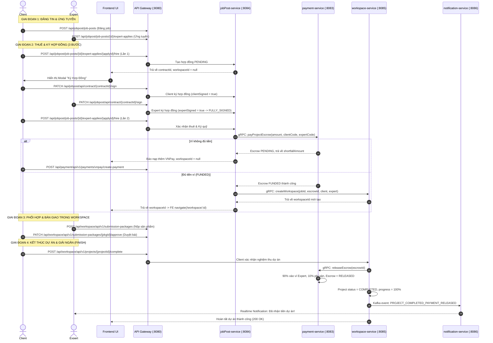
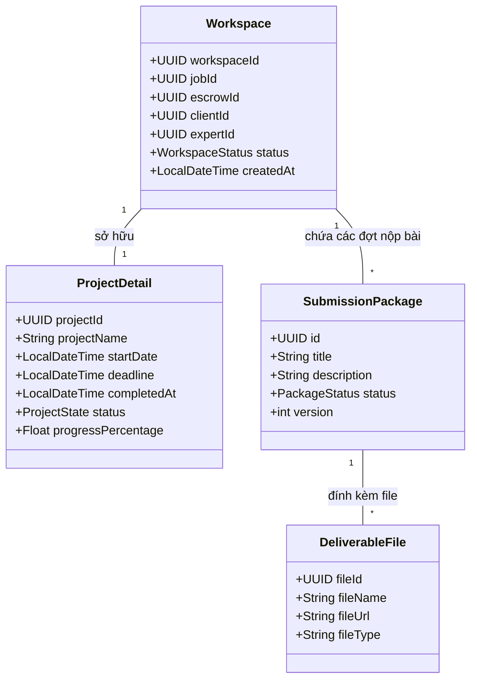

# TÀI LIỆU TOÀN DIỆN: LUỒNG NGHIỆP VỤ TỪ JOBPOST -> WORKSPACE -> FINISH DỰ ÁN
> **Dành cho:** Frontend Developer, Backend Developer & QA  
> **Cập nhật gần nhất:** Tháng 11/2026  
> **Hệ thống:** Microservices (API Gateway: `8080`, JobPost: `8084`, Workspace: `8085`, Payment: `8083`, Notification: `8086`)

---

## 📌 MỤC LỤC
1. [Tại sao Frontend hiện tại không làm được? (Root Causes & Khắc phục)](#1-tại-sao-frontend-hiện-tại-không-làm-được)
2. [Sơ đồ tuần tự tổng quan (End-to-End Sequence Diagram)](#2-sơ-đồ-tuần-tự-tổng-quan)
3. [Quy trình 4 Giai đoạn chi tiết](#3-quy-trình-4-giai-đoạn-chi-tiết)
   - [Giai đoạn 1: Đăng tin & Ứng tuyển (JobPost & Apply)](#giai-đoạn-1-đăng-tin--ứng-tuyển)
   - [Giai đoạn 2: Quy trình Thuê Expert & Ký Hợp Đồng (Hire & Sign)](#giai-đoạn-2-quy-trình-thuê-expert--ký-hợp-đồng-3-bước)
   - [Giai đoạn 3: Phối hợp & Bàn giao trong Workspace](#giai-đoạn-3-phối-hợp--bàn-giao-trong-workspace)
   - [Giai đoạn 4: Hoàn thành dự án & Giải ngân tiền (Finish & Release Escrow)](#giai-đoạn-4-hoàn-thành-dự-án--giải-ngân-tiền)
4. [Đặc tả kỹ thuật API Reference](#4-đặc-tả-kỹ-thuật-api-reference)
5. [Code mẫu Frontend (React / TypeScript Handler)](#5-code-mẫu-frontend-react--typescript)
6. [Checklist kiểm thử cho Tester & FE](#6-checklist-kiểm-thử-cho-fe--qa)

---

## 1. TẠI SAO FRONTEND HIỆN TẠI KHÔNG LÀM ĐƯỢC?

Sau khi rà soát toàn bộ source code của `jobPost-service`, `workspace-service`, `payment-service` và `api-gateway`, đây là **4 nguyên nhân chính** khiến Frontend đang bị lỗi / kẹt không thực hiện được luồng này:

### ❌ Nguyên nhân 1: Nhầm tưởng nút "Hire" là 1-Click tạo ngay Workspace
* **Thực tế Frontend đang làm:** FE bấm nút "Thuê / Hire" -> Mong đợi Backend trả về ngay `workspaceId` rồi gọi `router.push('/workspace/' + res.data.workspaceId)`.
* **Sự thật ở Backend:** Hệ thống được thiết kế theo **chuẩn hợp đồng pháp lý & ký quỹ tài chính**:
  1. **Lần gọi `/hire` thứ 1:** Backend **CHƯA TẠO WORKSPACE**. Backend chỉ phê duyệt ứng tuyển, tạo ra một bản `Contract` (Hợp đồng) có trạng thái `PENDING`, và trả về `contractId` với `workspaceId = null`!
  2. **Ký hợp đồng:** Cả Client và Expert phải bấm **Ký hợp đồng** (`PATCH /api/contract/{contractId}/sign`). Khi CẢ HAI cùng ký thì hợp đồng mới thành `FULLY_SIGNED`.
  3. **Lần gọi `/hire` thứ 2:** Client bấm "Xác nhận & Thuê" lại lần nữa. Lúc này Backend mới tiến hành trừ tiền ví Client vào Escrow (Ví chung). Nếu đủ tiền -> Backend mới gọi gRPC sang `workspace-service` để tạo Workspace và trả về `workspaceId`!
* 👉 **Khắc phục:** FE không được redirect ngay sau lần 1, mà phải mở Modal Ký hợp đồng cho Client và báo Expert ký, sau đó mới gọi `/hire` lần 2.

---

### ❌ Nguyên nhân 2: Kẹt tiền ký quỹ (Insufficient Balance / Shortfall Amount)
* Khi Client gọi `/hire` lần 2, Backend sẽ kiểm tra số dư ví Client (`walletBalance >= proposedBudget`).
* Nếu Client chưa nạp tiền hoặc số dư ví không đủ, Backend sẽ trả về `status: PENDING` kèm `shortfallAmount` (số tiền còn thiếu), ví dụ:
  ```json
  {
    "contractId": "...",
    "jobPostId": "...",
    "shortfallAmount": 1500000.0,
    "message": "Ví chung chưa đủ tiền. Vui lòng nạp thêm 1500000 qua VNPay rồi bấm Thuê Expert lại.",
    "workspaceId": null
  }
  ```
* 👉 **Khắc phục:** FE cần bắt trường `res.data.shortfallAmount`. Nếu có `shortfallAmount > 0`, hiển thị Modal: *"Số dư ví của bạn còn thiếu [X] VNĐ. Vui lòng nạp tiền qua VNPay để hoàn tất thuê Expert"* kèm nút dẫn sang trang nạp VNPay.

---

### ❌ Nguyên nhân 3: Truyền nhầm `workspaceId` vào API Finish Dự Án
* Khi đang ở màn hình Workspace, FE thường chỉ lưu `workspaceId` trên thanh URL (`/workspace/:workspaceId`).
* Khi Client bấm nút "Hoàn thành dự án", FE gọi API `POST /api/v1/projects/{projectId}/complete` nhưng lại truyền `workspaceId` vào `{projectId}`!
* Dẫn đến lỗi: `404 Project not found` hoặc `403 Access Denied`.
* 👉 **Cập nhật mới từ Backend:**
  1. Backend đã hỗ trợ cả 2 URL: 
     - `POST /api/workspace/api/v1/projects/{projectId}/complete`
     - `POST /api/workspace/api/v1/projects/workspace/{workspaceId}/complete`
  2. DTO `WorkspaceResponse` (khi gọi `GET /api/v1/workspaces/{workspaceId}`) đã được bổ sung thêm trường `projectId` để FE dùng trực tiếp.

---

### ❌ Nguyên nhân 4: Sai tiền tố định tuyến (Gateway Path Prefix)
* Mọi request từ Frontend phải đi qua **API Gateway cổng 8080**:
  - Service `jobPost-service`: Prefix là `/api/jobpost/...`
  - Service `workspace-service`: Prefix là `/api/workspace/api/v1/...` *(Đặc biệt lưu ý có `/api/v1/`)*
  - Service `payment-service`: Prefix là `/api/payment/api/v1/...`
* Nếu FE gọi thiếu `/api/v1` (ví dụ: `http://localhost:8080/api/workspace/workspaces/...`), Gateway sẽ rewrite sai dẫn tới lỗi `404 Not Found`.

---

## 2. SƠ ĐỒ TUẦN TỰ TỔNG QUAN



---

## 3. QUY TRÌNH 4 GIAI ĐOẠN CHI TIẾT

### Giai đoạn 1: Đăng tin & Ứng tuyển
1. **Client tạo bài đăng:** `POST /api/jobpost/job-posts`
2. **Expert nộp hồ sơ ứng tuyển:** `POST /api/jobpost/job-posts/{jobPostId}/expert-applies`
   * Body:
     ```json
     {
       "strategyDetail": "Kế hoạch thực hiện dự án chi tiết...",
       "proposedBudget": 5000000,
       "estimatedDays": 15
     }
     ```
3. Trạng thái của đơn ứng tuyển lúc này là `PENDING`.

---

### Giai đoạn 2: Quy trình Thuê Expert & Ký Hợp Đồng (3 BƯỚC)

#### 🔹 Bước 2.1: Client bấm nút "Thuê Expert" LẦN 1
* **API:** `POST /api/jobpost/job-posts/{jobPostId}/expert-applies/{expertApplyId}/hire`
* **Header:** `Authorization: Bearer <token_client>`
* **Backend xử lý:**
  - Chuyển `expertApply.status` -> `APPROVED`.
  - Chuyển các đơn ứng tuyển khác của job này -> `REJECTED`.
  - Chuyển `jobPost.status` -> `ASSIGNED`.
  - Tạo bản ghi `Contract` với trạng thái `PENDING`.
* **Response trả về cho FE:**
  ```json
  {
    "contractId": "48b6f3c0-7f2e-4e4b-9721-a1b2c3d4e5f6",
    "workspaceId": null,
    "jobPostId": "91a2b3c4-...",
    "expertCode": "EXP-12345",
    "message": "Thuê Expert thành công. Vui lòng ký hợp đồng để tiếp tục khởi tạo workspace.",
    "shortfallAmount": null
  }
  ```
* ⚠️ **FE Action:** 
  - Thấy `workspaceId == null` và có `contractId` -> Mở Modal chi tiết Hợp đồng.
  - Hiện nút **"Ký Hợp Đồng"** cho Client.

#### 🔹 Bước 2.2: Ký hợp đồng (Cả Client và Expert)
* **API:** `PATCH /api/jobpost/api/contract/{contractId}/sign`
* **Ai gọi:**
  - Client đăng nhập gọi -> Hệ thống đánh dấu `clientSigned = true`.
  - Expert đăng nhập gọi -> Hệ thống đánh dấu `expertSigned = true`.
* **Khi cả 2 bên cùng ký:** `contract.status` tự động chuyển thành `FULLY_SIGNED`.
* **FE Kiểm tra hợp đồng:** `GET /api/jobpost/api/contract/{contractId}`
  ```json
  {
    "id": "48b6f3c0-...",
    "clientSigned": true,
    "expertSigned": true,
    "status": "FULLY_SIGNED",
    "proposedBudget": 5000000,
    "workspaceId": null
  }
  ```

#### 🔹 Bước 2.3: Client bấm "Xác nhận & Khởi tạo Workspace" LẦN 2
* Khi hợp đồng đã `FULLY_SIGNED`, Client gọi lại đúng API hire ở Bước 2.1:
  `POST /api/jobpost/job-posts/{jobPostId}/expert-applies/{expertApplyId}/hire`
* **Trường hợp A: Ví Client thiếu tiền (Không đủ cọc):**
  - Response trả về:
    ```json
    {
      "contractId": "48b6f3c0-...",
      "workspaceId": null,
      "shortfallAmount": 2000000,
      "message": "Ví chung chưa đủ tiền. Vui lòng nạp thêm 2000000 qua VNPay rồi bấm Thuê Expert lại."
    }
    ```
  - **FE Action:** Bật popup nạp tiền VNPay cho Client (`POST /api/payment/api/v1/payments/vnpay/create-payment`). Nạp xong, bấm Thuê lại.
* **Trường hợp B: Ví Client đủ tiền (Ký quỹ thành công):**
  - Tiền cọc được khóa vào Escrow.
  - Backend tự động gọi gRPC sang `workspace-service` để khởi tạo phòng làm việc.
  - Response trả về:
    ```json
    {
      "contractId": "48b6f3c0-...",
      "workspaceId": "f7d98341-9257-41ab-a5a4-9273c5fbe2a1",
      "jobPostId": "...",
      "expertCode": "EXP-12345",
      "message": "Hợp đồng đã ký đủ, workspace đã được khởi tạo."
    }
    ```
  - 🚀 **FE Action:** Lúc này `workspaceId` đã có -> Điều hướng người dùng: `router.push('/workspace/' + res.data.workspaceId)`.

---

### Giai đoạn 3: Phối hợp & Bàn giao trong Workspace (Workspace & Project Architecture)

#### 3.1. Mô hình Đối tượng: Mối quan hệ giữa Workspace và Project
Trong hệ thống, một phòng làm việc được tổ chức theo cấu trúc phân tầng rõ ràng:
* **Workspace (Không gian làm việc):** Đại diện cho "căn phòng làm việc" cộng tác giữa 1 Client và 1 Expert, gắn với 1 `jobId` và 1 `escrowId` (ví cọc tiền). Quản lý thành viên, tài liệu và trạng thái phòng (`ACTIVE`, `SUSPENDED`, `CLOSED`).
* **ProjectDetail (Thông tin chi tiết dự án):** Là thực thể chứa dữ liệu nghiệp vụ của dự án trong phòng: `projectId`, `projectName`, ngày bắt đầu (`startDate`), hạn chót (`deadline`), ngày kết thúc (`completedAt`), trạng thái dự án (`ProjectState`: `IN_PROGRESS`, `COMPLETED`, `CANCELLED`), và tỷ lệ hoàn thành (`progressPercentage`: từ `0.0%` đến `100.0%`).
* **Quan hệ:** `Workspace` <-> `ProjectDetail` là quan hệ 1 - 1 (`@OneToOne`).



---

#### 3.2. Chi tiết các tính năng & API trong Workspace

##### 1. Truy vấn Timeline & Chi tiết Phòng làm việc:
* **API:** `GET /api/workspace/api/v1/workspaces/{workspaceId}`
* **Quyền:** Chỉ Client hoặc Expert thuộc phòng đó (hoặc Admin).
* **Response:**
  ```json
  {
    "workspaceId": "f7d98341-9257-41ab-a5a4-9273c5fbe2a1",
    "projectId": "13a8b2c4-8971-41bb-bfa0-372819cd9101",
    "jobId": "...",
    "escrowId": "e3b8a1c9-...",
    "status": "ACTIVE",
    "projectName": "Xây dựng website thương mại điện tử",
    "projectStatus": "IN_PROGRESS",
    "progressPercentage": 0.0,
    "startDate": "2026-11-14T08:00:00",
    "deadline": "2026-12-01T23:59:59",
    "createdAt": "2026-11-14T07:55:00",
    "client": {
      "userId": "327a98a5-4600-4f91-92e9-95f12f66f374",
      "name": "Nguyễn Văn Client",
      "avatarUrl": "https://..."
    },
    "expert": {
      "userId": "98a12345-1234-4f91-92e9-95f12f66f999",
      "name": "Trần Expert",
      "avatarUrl": "https://..."
    }
  }
  ```

##### 2. Danh sách phòng làm việc (Dashboard của User):
* **API:** `GET /api/workspace/api/v1/workspaces/dashboard?pageNo=0&pageSize=10`
* Tự động nhận diện đối tác `partner`: Nếu người đăng nhập là Client thì `partner` hiển thị tên/avatar Expert, và ngược lại.

##### 3. Quản lý Tài liệu Phòng làm việc (Workspace Document):
* **Lấy document:** `GET /api/workspace/api/workspace/{workspaceId}/document`
  * Trả về cờ `documentRequired: true` nếu Expert chưa cập nhật tài liệu lần nào (FE có thể mở popup nhắc nhở Expert).
* **Expert cập nhật document:** `PUT /api/workspace/api/workspace/{workspaceId}/document`
  * Body: `{"document": "Nội dung ghi chú hoặc link drive tài liệu..."}`

##### 4. Xem & Cập nhật Chiến lược dự án (Proposal Strategy):
* **Xem chiến lược đã duyệt:** `GET /api/workspace/api/workspace/{workspaceId}/proposal-strategy`
* **Cập nhật chiến lược:** `PATCH /api/workspace/api/workspace/{workspaceId}/proposal-strategy`
  * Body: `{"strategyDetail": "Cập nhật giải pháp kiến trúc..."}`

##### 5. Cập nhật Tiến độ & Trạng thái Dự án:
* **Cập nhật phần trăm tiến độ (0% - 100%):** `PUT /api/workspace/api/v1/projects/progress`
  * Body: `{"projectId": "...", "progressPercentage": 75.0}`
  * *(Lưu ý: Nếu cập nhật >= 100%, Backend tự động chuyển status sang `COMPLETED`)*.
* **Cập nhật trạng thái dự án:** `PUT /api/workspace/api/v1/projects/status`
  * Body: `{"projectId": "...", "status": "IN_PROGRESS"}`
* **Cập nhật thông tin tổng quan (Tên, Deadline):** `PUT /api/workspace/api/v1/projects/info`
  * Body: `{"projectId": "...", "projectName": "...", "startDate": "...", "deadline": "..."}`

##### 6. Quy trình Giao nhận Sản phẩm (Submission Packages):
* **Expert nộp gói sản phẩm mới:** `POST /api/workspace/api/v1/submission-packages`
  * Body:
    ```json
    {
      "workspaceId": "f7d98341-9257-41ab-a5a4-9273c5fbe2a1",
      "title": "Bàn giao Giai đoạn 1 - Source code & Database",
      "description": "Đã hoàn thành module Auth, CRUD sản phẩm.",
      "fileUrls": [
        "https://storage.domain.com/delivery_v1.zip"
      ]
    }
    ```
* **Lấy danh sách các gói nộp của phòng:** `GET /api/workspace/api/v1/submission-packages/workspaces/{workspaceId}`
* **Xem chi tiết 1 gói nộp kèm danh sách file:** `GET /api/workspace/api/v1/submission-packages/{packageId}`
* **Client duyệt bài bàn giao:** `PATCH /api/workspace/api/v1/submission-packages/{packageId}/approve`
  * Body: `{"feedback": "Đã kiểm tra chất lượng, nghiệm thu đợt 1."}`
* **Client từ chối / Yêu cầu sửa:** `PATCH /api/workspace/api/v1/submission-packages/{packageId}/reject`
  * Body: `{"feedback": "Thiếu unit test và lỗi responsive trên mobile."}`
* **Expert nộp lại bản sửa đổi (Resubmit):** `POST /api/workspace/api/v1/submission-packages/{packageId}/resubmit`
  * Tự động tăng version lên v2, v3... để theo dõi lịch sử chỉnh sửa.

##### 7. Quản lý File Bàn giao chi tiết (Deliverable Files):
* `GET /api/workspace/api/v1/deliverable-files/packages/{packageId}`: Xem danh sách file của gói.
* `POST /api/workspace/api/v1/deliverable-files`: Đăng tải/bổ sung file vào gói đã tạo.
* `DELETE /api/workspace/api/v1/deliverable-files/{fileId}`: Xóa file khỏi gói.

---

### Giai đoạn 4: Hoàn thành dự án & Giải ngân tiền (Finish & Release Escrow)

Khi Expert đã hoàn thành toàn bộ khối lượng công việc, Client (hoặc Admin) bấm **"Hoàn thành dự án / Kết thúc hợp đồng"**.

#### 🔹 API Hoàn tất dự án:
* **Cách 1 (Dùng `projectId`):**  
  `POST /api/workspace/api/v1/projects/{projectId}/complete`
* **Cách 2 (Dùng `workspaceId` - Backend đã hỗ trợ linh hoạt):**  
  `POST /api/workspace/api/v1/projects/{workspaceId}/complete`  
  hoặc `POST /api/workspace/api/v1/projects/workspace/{workspaceId}/complete`
* **Header:** `Authorization: Bearer <token_client>`

#### 🔹 Cơ chế tự động ở Backend khi bấm Hoàn tất:
1. **Kiểm tra quyền:** Chỉ có Client của dự án này (hoặc Admin) mới được quyền hoàn tất.
2. **Giải ngân tự động qua gRPC:** `workspace-service` gọi `payment-service` thông qua hàm `releaseEscrow(escrowId)`:
   - Toàn bộ `heldAmount` (90% tổng ngân sách) được chuyển thẳng vào **Số dư ví của Expert**.
   - 10% được tính vào doanh thu phí nền tảng (`platformFee`).
   - Trạng thái Escrow đổi thành `RELEASED`.
   - Sinh bản ghi giao dịch `PROJECT_RELEASE` thành công.
3. **Cập nhật dự án:**
   - `project.status = COMPLETED`
   - `project.progressPercentage = 100.0%`
   - `project.completedAt = LocalDateTime.now()`
4. **Bắn thông báo Realtime:**
   - Sự kiện Kafka `PROJECT_COMPLETED_PAYMENT_RELEASED` được kích hoạt.
   - `notification-service` lập tức gửi thông báo qua WebSocket đến tài khoản của Expert: *"Dự án đã được nghiệm thu và số tiền đã được chuyển vào ví của bạn!"*.

---

## 4. ĐẶC TẢ KỸ THUẬT API REFERENCE

Tất cả các API dưới đây được gọi qua **API Gateway: `http://localhost:8080`**.

| STT | Tên nghiệp vụ | Method | Đường dẫn API đầy đủ (qua Gateway) | Quyền gọi (Role) | Chú thích quan trọng |
|---|---|---|---|---|---|
| 1 | Đăng tin tuyển dụng | `POST` | `/api/jobpost/job-posts` | `CLIENT` | |
| 2 | Expert ứng tuyển | `POST` | `/api/jobpost/job-posts/{jobPostId}/expert-applies` | `EXPERT` | Kèm `proposedBudget`, `estimatedDays` |
| 3 | **Thuê Expert (Lần 1 & 2)** | `POST` | `/api/jobpost/job-posts/{jobPostId}/expert-applies/{applyId}/hire` | `CLIENT` | Lần 1 trả `contractId`, lần 2 trả `workspaceId` |
| 4 | Xem chi tiết Hợp đồng | `GET` | `/api/jobpost/api/contract/{contractId}` | `CLIENT`, `EXPERT` | Kiểm tra xem ai đã ký, ai chưa |
| 5 | **Ký Hợp đồng** | `PATCH` | `/api/jobpost/api/contract/{contractId}/sign` | `CLIENT`, `EXPERT` | Cả 2 bên phải gọi API này |
| 6 | Tạo link nạp tiền VNPay | `POST` | `/api/payment/api/v1/payments/vnpay/create-payment` | Đã đăng nhập | Dùng khi `shortfallAmount > 0` |
| 7 | Dashboard Workspaces | `GET` | `/api/workspace/api/v1/workspaces/dashboard` | Đã đăng nhập | Có phân trang `pageNo`, `pageSize` |
| 8 | **Chi tiết Workspace** | `GET` | `/api/workspace/api/v1/workspaces/{workspaceId}` | Client/Expert của phòng | Trả về cả `projectId` |
| 9 | Chi tiết Dự án | `GET` | `/api/workspace/api/v1/projects/workspace/{workspaceId}` | Client/Expert của phòng | Lấy chi tiết tiến độ, deadline |
| 10 | Expert nộp bài | `POST` | `/api/workspace/api/v1/submission-packages` | `EXPERT` | Kèm file link bàn giao |
| 11 | Expert nộp lại bài sửa | `POST` | `/api/workspace/api/v1/submission-packages/{packageId}/resubmit` | `EXPERT` | Tạo version mới sau khi bị reject |
| 12 | Client duyệt bài | `PATCH` | `/api/workspace/api/v1/submission-packages/{packageId}/approve` | `CLIENT` | |
| 13 | Client từ chối bài | `PATCH` | `/api/workspace/api/v1/submission-packages/{packageId}/reject` | `CLIENT` | Kèm lý do chỉnh sửa |
| 14 | Cập nhật tiến độ dự án | `PUT` | `/api/workspace/api/v1/projects/progress` | Thành viên phòng | Nhập % từ `0.0` đến `100.0` |
| 15 | Cập nhật trạng thái dự án | `PUT` | `/api/workspace/api/v1/projects/status` | Thành viên phòng | `IN_PROGRESS`, `DONE`... |
| 16 | Tài liệu phòng làm việc | `GET` | `/api/workspace/api/workspace/{workspaceId}/document` | Thành viên phòng | Check `documentRequired` |
| 17 | Cập nhật tài liệu phòng | `PUT` | `/api/workspace/api/workspace/{workspaceId}/document` | `EXPERT` | Expert cập nhật link/doc |
| 18 | Chiến lược dự án | `GET` | `/api/workspace/api/workspace/{workspaceId}/proposal-strategy` | Thành viên phòng | Xem giải pháp đã duyệt |
| 19 | **Hoàn thành dự án & Giải ngân** | `POST` | `/api/workspace/api/v1/projects/{projectId}/complete` *(hoặc `{workspaceId}`)* | `CLIENT` | Giải ngân tiền ví & hoàn tất 100% |

---

## 5. CODE MẪU FRONTEND (REACT / TYPESCRIPT)

### 1. Hook xử lý Thuê Expert & Ký hợp đồng (`useHireExpert.ts`)

```typescript
import { useState } from 'react';
import axios from 'axios';

const GATEWAY_URL = 'http://localhost:8080';

export const useHireExpert = () => {
  const [loading, setLoading] = useState(false);
  const [contractModalData, setContractModalData] = useState<any>(null);

  const token = localStorage.getItem('token');
  const headers = { Authorization: `Bearer ${token}` };

  /**
   * Bước 1 & Bước 3: Gọi API Hire
   */
  const handleHire = async (jobPostId: string, expertApplyId: string, navigate: any) => {
    setLoading(true);
    try {
      const res = await axios.post(
        `${GATEWAY_URL}/api/jobpost/job-posts/${jobPostId}/expert-applies/${expertApplyId}/hire`,
        {},
        { headers }
      );

      const data = res.data;

      // TRƯỜNG HỢP 1: Lần đầu bấm Thuê -> Nhận contractId, chưa có workspace
      if (data.contractId && !data.workspaceId && !data.shortfallAmount) {
        // Tải chi tiết hợp đồng và mở modal cho Client ký
        const contractRes = await axios.get(
          `${GATEWAY_URL}/api/jobpost/api/contract/${data.contractId}`,
          { headers }
        );
        setContractModalData(contractRes.data);
        return;
      }

      // TRƯỜNG HỢP 2: Ví thiếu tiền -> Hướng dẫn nạp tiền
      if (data.shortfallAmount && data.shortfallAmount > 0) {
        alert(
          `Số dư ví không đủ! Cần nạp thêm ${data.shortfallAmount.toLocaleString()} VNĐ qua VNPay.`
        );
        // Chuyển sang màn hình nạp tiền hoặc mở Modal VNPay
        navigate('/wallet/deposit', { state: { amount: data.shortfallAmount } });
        return;
      }

      // TRƯỜNG HỢP 3: Đã ký đủ và đủ tiền -> Đã tạo Workspace thành công!
      if (data.workspaceId) {
        alert('Thuê thành công! Đang chuyển đến phòng làm việc...');
        navigate(`/workspace/${data.workspaceId}`);
        return;
      }
    } catch (err: any) {
      alert(err.response?.data?.message || 'Có lỗi xảy ra khi thuê Expert');
    } finally {
      setLoading(false);
    }
  };

  /**
   * Bước 2: Ký hợp đồng
   */
  const handleSignContract = async (contractId: string, onSuccess: () => void) => {
    try {
      await axios.patch(
        `${GATEWAY_URL}/api/jobpost/api/contract/${contractId}/sign`,
        {},
        { headers }
      );
      alert('Ký hợp đồng thành công! Vui lòng chờ đối tác ký hoặc bấm Xác nhận Thuê.');
      if (onSuccess) onSuccess();
    } catch (err: any) {
      alert(err.response?.data?.message || 'Ký hợp đồng thất bại');
    }
  };

  return { handleHire, handleSignContract, contractModalData, loading };
};
```

---

### 2. Xử lý nút "Hoàn thành dự án" (`CompleteProjectButton.tsx`)

```typescript
import React, { useState } from 'react';
import axios from 'axios';

interface Props {
  workspaceId: string;
  projectId?: string; // Nếu có projectId truyền vào, không có thì dùng workspaceId
  onFinished?: () => void;
}

export const CompleteProjectButton: React.FC<Props> = ({ workspaceId, projectId, onFinished }) => {
  const [loading, setLoading] = useState(false);

  const handleComplete = async () => {
    const confirm = window.confirm(
      'Bạn có chắc chắn muốn nghiệm thu và kết thúc dự án? Số tiền ký quỹ (90%) sẽ được chuyển ngay vào ví của Expert.'
    );
    if (!confirm) return;

    setLoading(true);
    try {
      const token = localStorage.getItem('token');
      // Backend đã hỗ trợ linh hoạt cả projectId lẫn workspaceId:
      const targetId = projectId || workspaceId;
      
      const res = await axios.post(
        `http://localhost:8080/api/workspace/api/v1/projects/${targetId}/complete`,
        {},
        {
          headers: { Authorization: `Bearer ${token}` }
        }
      );

      alert('Dự án đã được nghiệm thu và giải ngân tiền cho Expert thành công!');
      if (onFinished) onFinished();
    } catch (err: any) {
      alert(err.response?.data?.message || 'Không thể hoàn tất dự án. Vui lòng thử lại.');
    } finally {
      setLoading(false);
    }
  };

  return (
    <button
      onClick={handleComplete}
      disabled={loading}
      style={{
        backgroundColor: '#10b981',
        color: '#fff',
        padding: '10px 20px',
        borderRadius: '6px',
        border: 'none',
        cursor: 'pointer'
      }}
    >
      {loading ? 'Đang xử lý giải ngân...' : '✅ Hoàn Thành Dự Án & Giải Ngân'}
    </button>
  );
};
```

---

## 6. CHECKLIST KIỂM THỬ CHO FE & QA

| Bước | Hành động | Kết quả mong đợi | Đạt? |
|---|---|---|---|
| **1** | Client bấm nút "Thuê" lần đầu | Nhận `contractId`, `workspaceId: null`. Mở Modal Hợp đồng. | 🔲 |
| **2** | Client bấm "Ký hợp đồng" | `clientSigned = true`. Trạng thái hợp đồng cập nhật. | 🔲 |
| **3** | Đăng nhập Expert bấm "Ký hợp đồng" | `expertSigned = true`. Trạng thái hợp đồng chuyển thành `FULLY_SIGNED`. | 🔲 |
| **4** | Client bấm "Thuê" lần 2 (Ví không đủ tiền) | Trả về `shortfallAmount > 0`. Báo Client nạp tiền qua VNPay. | 🔲 |
| **5** | Nạp tiền vào ví qua VNPay | Số dư ví Client tăng lên đủ `proposedBudget`. | 🔲 |
| **6** | Client bấm "Thuê" lần 2 (Đủ tiền) | Trả về `workspaceId != null`. Điều hướng vào `/workspace/:workspaceId`. | 🔲 |
| **7** | Vào Workspace | Hiển thị thông tin dự án, Client, Expert, deadline chính xác. | 🔲 |
| **8** | Expert nộp bài bàn giao | Package xuất hiện trong Workspace. Client nhận được thông báo. | 🔲 |
| **9** | Client duyệt bài bàn giao | Package chuyển sang trạng thái `APPROVED`. | 🔲 |
| **10** | Client bấm "Hoàn thành dự án" | Gọi `/complete`, dự án chuyển thành `COMPLETED`, 100%. Tiền vào ví Expert. | 🔲 |
| **11** | Expert kiểm tra ví | Số dư ví Expert tăng thêm 90% ngân sách dự án. | 🔲 |
| **12** | Expert nhận thông báo Realtime | Notification popup / badge báo tiền giải ngân về ví. | 🔲 |
