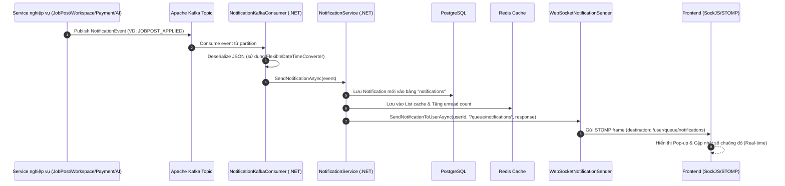

# 📡 Tài Liệu Kiến Trúc & Tích Hợp Real-time Notification Service (.NET 8)

Dịch vụ `notification-service` đảm nhiệm việc tiếp nhận các sự kiện nghiệp vụ từ toàn bộ hệ thống microservices qua **Apache Kafka**, lưu trữ vào cơ sở dữ liệu **PostgreSQL**, tối ưu tốc độ đọc qua **Redis Cache**, và phát thông báo tức thời (Real-time) đến giao diện người dùng (Frontend) qua **WebSocket / STOMP (hỗ trợ SockJS)** và **SignalR**.

---

## 📌 Mục Lục
1. [Nguyên nhân gây mất Real-time trước đây & Cách đã khắc phục](#1-nguyên-nhân-gây-mất-real-time-trước-đây--cách-đã-khắc-phục)
2. [Kiến trúc luồng xử lý thông báo (Data Flow)](#2-kiến-trúc-luồng-xử-lý-thông-báo-data-flow)
3. [Hướng dẫn tích hợp phía Frontend (Client Integration)](#3-hướng-dẫn-tích-hợp-phía-frontend-client-integration)
   - [Cách 1: Dùng SockJS + STOMP (Khuyên dùng cho React/Vue/Angular)](#cách-1-kết-nối-bằng-sockjs--stompjs-khuyên-dùng)
   - [Cách 2: Dùng Native WebSocket + STOMP](#cách-2-kết-nối-bằng-native-websocket--stompjs)
   - [Cách 3: Dùng SignalR Client](#cách-3-kết-nối-bằng-signalr-microsoftsignalr)
4. [Danh sách REST API & Endpoint Test](#4-danh-sách-rest-api--endpoint-test)
5. [Cấu hình Cổng & Môi trường](#5-cấu-hình-cổng--môi-trường)

---

## 1. Nguyên nhân gây mất Real-time trước đây & Cách đã khắc phục

| STT | Vấn đề phát hiện | Hậu quả | Giải pháp đã khắc phục |
| :---: | :--- | :--- | :--- |
| **1** | **Poison Pill từ Kafka (`occurredAt`)** | Java Spring Boot serialize `LocalDateTime` dạng mảng `[year, month, day, hour, min, sec]`. Bộ giải mã mặc định của .NET chỉ đọc string ISO, văng Exception `InvalidOperationException: Cannot get token type 'StartArray' as a string`. Consumer bị kẹt lặp lại liên tục, **toàn bộ event Kafka bị chặn đứng**. | Đã viết `FlexibleDateTimeConverter` hỗ trợ linh hoạt cả chuỗi ISO-8601 lẫn định dạng mảng int của Jackson; đồng thời xử lý commit an toàn khi gặp dữ liệu lỗi. |
| **2** | **Lỗi giao thức SockJS Framing** | Frontend dùng `new SockJS(...)` kết nối vào WebSocket (`/.../websocket`), giao thức SockJS bắt buộc server phải gửi **Open Frame `'o'`** đầu tiên và đóng gói message dạng **`a["..."]`**. Trước đây server gửi raw text làm SockJS phía FE đứng chờ vô tận hoặc văng lỗi JSON syntax. | Đã triển khai chuẩn SockJS protocol: gửi frame `'o'` ngay khi mở kết nối, tự động unwrap mảng `["..."]` khi nhận và wrap `a["..."]` khi gửi. |
| **3** | **Không nhận diện được User ID** | Trình duyệt Web không cho phép gán Header tùy biến (như `X-User-Id`) khi khởi tạo WebSocket JS. Trước đây code chỉ đọc header này nên gán user là `anonymous` $\rightarrow$ Khi có thông báo cho user, server tìm không ra session nên không gửi được. | Bổ sung cơ chế trích xuất `userId` từ Query Parameter (`?userId=...` hoặc `?token=Bearer ...`) và từ Header của khung STOMP `CONNECT` (`userId` hoặc `Authorization: Bearer <JWT>`). |
| **4** | **Lệch Destination & Subscription ID** | Server trước đây ép cứng destination trả về là `/user/{userId}/queue/notifications` kèm `sub-0`, trong khi FE đăng ký `/user/queue/notifications` với ID đăng ký riêng $\rightarrow$ thư viện STOMP của FE loại bỏ message vì không khớp. | Đã khớp chính xác Destination và `subscriptionId` mà Frontend đã đăng ký khi gửi frame `MESSAGE`. |
| **5** | **Rớt kết nối khi rảnh (Timeout)** | Không có heartbeat định kỳ khiến proxy hoặc browser tự ngắt kết nối sau 30-60 giây. | Thêm cơ chế gửi Heartbeat định kỳ 25 giây (`h` cho SockJS, `\n` cho STOMP). |
| **6** | **Chặn WebSocket ở API Gateway** | Gateway chặn các endpoint SockJS và WebSocket do thiếu cấu hình public. | Đã bổ sung `/notification/ws/**`, `/notification/hubs/**`, `/notification/**/test` vào `public-endpoints` của API Gateway. |

---

## 2. Kiến trúc luồng xử lý thông báo (Data Flow)



---

## 3. Hướng dẫn tích hợp phía Frontend (Client Integration)

Frontend có thể kết nối thông qua **API Gateway** (`http://localhost:8080/api/notification`) hoặc kết nối trực tiếp đến **Notification Service** (`http://localhost:8086`).

### Cách 1: Kết nối bằng SockJS + STOMP.js (Khuyên dùng)

Cài đặt thư viện:
```bash
npm install sockjs-client @stomp/stompjs
# hoặc dùng thư viện cũ stompjs
npm install sockjs-client stompjs
```

#### Code mẫu với `@stomp/stompjs` (phiên bản mới):
```typescript
import { Client } from '@stomp/stompjs';
import SockJS from 'sockjs-client';

const currentUserId = 'e1c6d3ca-a825-4cd1-8cc1-92dc32c13234'; // ID user đăng nhập
const accessToken = localStorage.getItem('token'); // JWT Token nếu có

// 1. Tạo factory SockJS (chọn 1 trong 2 URL: qua Gateway hoặc trực tiếp)
const socketUrl = `http://localhost:8080/api/notification/ws/notifications?userId=${currentUserId}`;
// Hoặc kết nối trực tiếp: `http://localhost:8086/ws/notifications?userId=${currentUserId}`

const stompClient = new Client({
  webSocketFactory: () => new SockJS(socketUrl),
  connectHeaders: {
    userId: currentUserId,
    Authorization: `Bearer ${accessToken}`
  },
  debug: (str) => console.log('[STOMP Debug]:', str),
  reconnectDelay: 5000, // Tự kết nối lại sau 5s nếu mất mạng
  heartbeatIncoming: 25000,
  heartbeatOutgoing: 25000
});

stompClient.onConnect = (frame) => {
  console.log('✅ Đã kết nối STOMP thành công!', frame);

  // 2. Subscribe nhận thông báo cá nhân
  stompClient.subscribe('/user/queue/notifications', (message) => {
    if (message.body) {
      const notification = JSON.parse(message.body);
      console.log('🔔 Nhận thông báo mới:', notification);
      
      // Xử lý UI: Hiển thị Toast / Popup thông báo
      // alert(`${notification.title}: ${notification.message}`);
    }
  });
};

stompClient.onStompError = (frame) => {
  console.error('❌ Lỗi STOMP Broker:', frame.headers['message'], frame.body);
};

// Kích hoạt kết nối
stompClient.activate();
```

---

### Cách 2: Kết nối bằng Native WebSocket + STOMP.js
Nếu không muốn phụ thuộc thư viện SockJS:

```typescript
import { Client } from '@stomp/stompjs';

const currentUserId = 'e1c6d3ca-a825-4cd1-8cc1-92dc32c13234';

const stompClient = new Client({
  // Kết nối thẳng qua giao thức ws://
  brokerURL: `ws://localhost:8080/api/notification/ws/notifications?userId=${currentUserId}`,
  connectHeaders: {
    userId: currentUserId
  },
  reconnectDelay: 5000
});

stompClient.onConnect = () => {
  console.log('✅ WebSocket STOMP Connected!');
  stompClient.subscribe('/user/queue/notifications', (msg) => {
    const data = JSON.parse(msg.body);
    console.log('🔔 Notification received:', data);
  });
};

stompClient.activate();
```

---

### Cách 3: Kết nối bằng SignalR (`@microsoft/signalr`)
Notification Service hỗ trợ song song cả SignalR Hub:

```typescript
import * as signalR from '@microsoft/signalr';

const currentUserId = 'e1c6d3ca-a825-4cd1-8cc1-92dc32c13234';

const connection = new signalR.HubConnectionBuilder()
  .withUrl(`http://localhost:8080/api/notification/hubs/notifications?userId=${currentUserId}`)
  .withAutomaticReconnect()
  .build();

// Đăng ký event nhận thông báo
connection.on('ReceiveNotification', (notification) => {
  console.log('🔔 [SignalR] Nhận thông báo:', notification);
});

async function start() {
  try {
    await connection.start();
    console.log('✅ SignalR Connected!');
  } catch (err) {
    console.error('❌ SignalR Connect error:', err);
    setTimeout(start, 5000);
  }
}

start();
```

---

## 4. Danh sách REST API & Endpoint Test

| Method | Endpoint (Gọi qua Gateway) | Endpoint (Gọi trực tiếp) | Mô tả |
| :--- | :--- | :--- | :--- |
| `GET` | `/api/notification/v1/notifications/user/{userId}` | `/api/v1/notifications/user/{userId}` | Lấy danh sách thông báo của user (ưu tiên đọc Redis) |
| `GET` | `/api/notification/v1/notifications/user/{userId}/unread-count` | `/api/v1/notifications/user/{userId}/unread-count` | Đếm số thông báo chưa đọc (ưu tiên đọc Redis) |
| `PUT` | `/api/notification/v1/notifications/user/{userId}/read-all` | `/api/v1/notifications/user/{userId}/read-all` | Đánh dấu tất cả thông báo là đã đọc |
| `PUT` | `/api/notification/v1/notifications/{id}/read` | `/api/v1/notifications/{id}/read` | Đánh dấu 1 thông báo là đã đọc |
| `POST` | `/api/notification/v1/notifications/test` | `/api/v1/notifications/test` | **Test bắn thông báo Real-time tức thì** |
| `GET` | `/api/notification/ws/notifications/info` | `/ws/notifications/info` | SockJS handshake info endpoint |

### Hướng dẫn Test bắn thông báo Real-time bằng REST API
Bạn có thể dùng Postman hoặc Terminal gọi endpoint sau để kiểm tra xem Frontend có nhận được pop-up ngay lập tức hay không mà không cần tạo luồng nghiệp vụ phức tạp:

**Request:**
```http
POST http://localhost:8080/api/notification/v1/notifications/test
Content-Type: application/json

{
  "recipientUserId": "e1c6d3ca-a825-4cd1-8cc1-92dc32c13234",
  "title": "Dự án mới",
  "message": "Bạn đã được mời tham gia vào workspace mới!",
  "type": "WORKSPACE_INVITED",
  "deeplink": "/workspaces/123"
}
```

**Response (200 OK):**
```json
{
  "success": true,
  "message": "Real-time notification dispatched via WebSocket and SignalR.",
  "recipientUserId": "e1c6d3ca-a825-4cd1-8cc1-92dc32c13234",
  "title": "Dự án mới",
  "content": "Bạn đã được mời tham gia vào workspace mới!"
}
```

---

## 5. Cấu hình Cổng & Môi trường

- **Cổng dịch vụ nội bộ:** `8086`
- **Cổng qua API Gateway:** `8080` (Prefix: `/api/notification/**`)
- **Database:** PostgreSQL (Port `5432`, Database: `notification`)
- **Cache:** Redis (Port `6379`)
- **Kafka:** `localhost:9092` (Consumer Group: `notification-service`)
- **Service Discovery:** Eureka (`http://localhost:8761/eureka/`)
