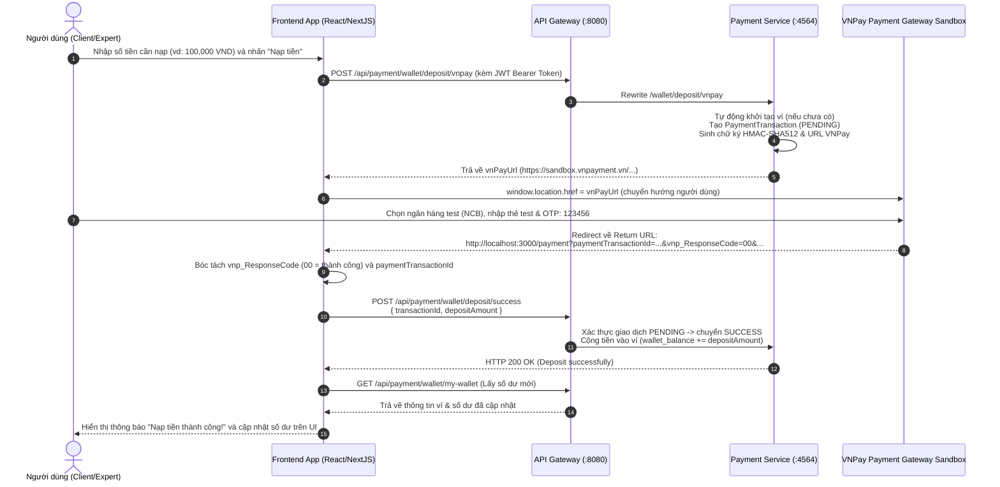

# TÀI LIỆU TÍCH HỢP PAYMENT SERVICE & HƯỚNG DẪN GỌI API CHO FRONTEND (VNPay Wallet Deposit)

Tài liệu này hướng dẫn chi tiết nghiệp vụ, luồng gọi API, đặc tả request/response và code mẫu Frontend (React / Axios / TypeScript) để tích hợp tính năng **Nạp tiền vào ví qua VNPay (Sandbox)** và kiểm tra số dư ví.

---

## 1. Tổng quan kiến trúc & Luồng nghiệp vụ (Workflow)

Hệ thống thanh toán `payment-service` tích hợp VNPay Sandbox với luồng thanh toán chuyển hướng (Redirect URL) 2 bước:



---

## 2. Thông tin kết nối & Cấu hình môi trường

| Thành phần | Địa chỉ qua API Gateway (Khuyến nghị cho FE) | Địa chỉ gọi trực tiếp (Local Test) |
| :--- | :--- | :--- |
| **Base URL** | `http://localhost:8080/api/payment` | `http://localhost:4564` |
| **Return URL Frontend** | `http://localhost:3000/payment` | Được cấu hình trong `vnpay.return-url` |
| **Môi trường** | VNPay Sandbox Gateway | `https://sandbox.vnpayment.vn/paymentv2/vpcpay.html` |
| **Terminal Code (TMN)** | `FCSU007M` | Cấu hình trong payment-service |

---

## 3. Đặc tả chi tiết các API dành cho Frontend

### 3.1. API Tạo yêu cầu nạp tiền & lấy liên kết VNPay

* **Phương thức:** `POST`
* **URL qua Gateway:** `http://localhost:8080/api/payment/wallet/deposit/vnpay`
* **URL gọi trực tiếp:** `http://localhost:4564/wallet/deposit/vnpay` hoặc `http://localhost:4564/api/wallet/deposit/vnpay`
* **Headers:**
  ```http
  Authorization: Bearer <USER_JWT_TOKEN>
  Content-Type: application/json
  ```
* **Request Body** *(Hỗ trợ cả JSON Body hoặc Query Parameters):*
  ```json
  {
    "depositAmount": 100000,
    "description": "Nạp tiền vào ví cá nhân"
  }
  ```
  *(Lưu ý: `depositAmount` tính theo đơn vị VNĐ, tối thiểu là 10,000 VNĐ theo quy định VNPay).*

* **Response Success (HTTP 200 OK):**
  ```json
  {
    "status": 200,
    "message": "Create VNPay payment URL successfully",
    "result": "https://sandbox.vnpayment.vn/paymentv2/vpcpay.html?vnp_Amount=10000000&vnp_Command=pay&vnp_CreateDate=20261114024601&vnp_CurrCode=VND&vnp_IpAddr=127.0.0.1&vnp_Locale=vn&vnp_OrderInfo=Thanh+toan+cho+ma+GD%3A+ced0e4aa-6afe-4e2b-aeb0-9e3cad1348ba&vnp_OrderType=other&vnp_ReturnUrl=http%3A%2F%2Flocalhost%3A3000%2Fpayment%3FpaymentTransactionId%3Dced0e4aa-6afe-4e2b-aeb0-9e3cad1348ba&vnp_TmnCode=FCSU007M&vnp_TxnRef=b08f4cb7e324424687d69b3ee9782500&vnp_Version=2.1.0&vnp_SecureHash=7d4044816c7..."
  }
  ```

* **Xử lý phía FE:**
  Lấy URL từ `response.data.result` và thực hiện chuyển trang:
  ```javascript
  window.location.href = response.data.result;
  ```

---

### 3.2. API Xác nhận nạp tiền thành công (Gọi sau khi VNPay Callback về FE)

Khi người dùng thanh toán xong trên VNPay Sandbox, VNPay sẽ redirect trình duyệt về đường dẫn:
```text
http://localhost:3000/payment?paymentTransactionId=ced0e4aa-6afe-4e2b-aeb0-9e3cad1348ba&vnp_Amount=10000000&vnp_BankCode=NCB&vnp_BankTranNo=VNP14300000&vnp_CardType=ATM&vnp_OrderInfo=...&vnp_PayDate=...&vnp_ResponseCode=00&vnp_TmnCode=FCSU007M&vnp_TransactionNo=...&vnp_TransactionStatus=00&vnp_TxnRef=...&vnp_SecureHash=...
```

Frontend kiểm tra `vnp_ResponseCode === '00'` (thành công), sau đó gọi API này để backend chốt giao dịch và cộng tiền vào ví.

* **Phương thức:** `POST`
* **URL qua Gateway:** `http://localhost:8080/api/payment/wallet/deposit/success`
* **URL gọi trực tiếp:** `http://localhost:4564/wallet/deposit/success` hoặc `http://localhost:4564/api/wallet/deposit/success`
* **Headers:**
  ```http
  Authorization: Bearer <USER_JWT_TOKEN>
  Content-Type: application/json
  ```
* **Request Body** *(Hỗ trợ cả JSON Body hoặc Query Parameters):*
  ```json
  {
    "transactionId": "ced0e4aa-6afe-4e2b-aeb0-9e3cad1348ba",
    "depositAmount": 100000
  }
  ```
  *(Lưu ý: Nếu không truyền `depositAmount`, hệ thống sẽ tự động dùng số tiền gốc của giao dịch `transactionId` đã lưu).*

* **Response Success (HTTP 200 OK):**
  ```json
  {
    "status": 200,
    "message": "Deposit successfully",
    "result": null
  }
  ```

* **Mã lỗi thường gặp:**
  - `400`: `transactionId is required` (thiếu transactionId).
  - `400`: `Cannot complete deposit transaction with status: SUCCESS` (giao dịch đã được xác nhận trước đó, tránh cộng tiền 2 lần).
  - `400`: `Deposit amount does not match the payment transaction` (số tiền truyền lên không khớp số tiền giao dịch đã đăng ký).

---

### 3.3. API Lấy thông tin ví của tôi (Xem số dư)

* **Phương thức:** `GET`
* **URL qua Gateway:** `http://localhost:8080/api/payment/wallet/my-wallet`
* **URL gọi trực tiếp:** `http://localhost:4564/wallet/my-wallet` hoặc `http://localhost:4564/api/wallet/my-wallet`
* **Headers:**
  ```http
  Authorization: Bearer <USER_JWT_TOKEN>
  ```
* **Response Success (HTTP 200 OK):**
  ```json
  {
    "status": 200,
    "message": "Get my wallet successfully",
    "result": {
      "id": "c976875c-73dd-449e-a416-17dc45b8716e",
      "userCode": "EXP-0OWV397ZK4",
      "walletBalance": 100000.00,
      "totalEarned": 0.00,
      "totalWithdrawn": 0.00,
      "status": "ACTIVE",
      "bankName": null,
      "accountNumber": null,
      "accountHolderName": null,
      "requestWithdrawal": false,
      "amountRequestWithdrawal": null
    }
  }
  ```

---

## 4. Thông tin thẻ Test VNPay Sandbox

Khi chuyển hướng tới trang thanh toán Sandbox của VNPay, sử dụng thông tin sau để thanh toán:

| Trường | Giá trị Test |
| :--- | :--- |
| **Ngân hàng** | Chọn ngân hàng **NCB** |
| **Số thẻ** | `9704198526191432198` |
| **Tên chủ thẻ** | `NGUYEN VAN A` |
| **Ngày phát hành** | `07/15` |
| **Mật khẩu OTP** | `123456` |

---

## 5. Code mẫu Frontend hoàn chỉnh (React / Axios / TypeScript)

### 5.1. Component Form Nạp tiền (`DepositModal.tsx` hoặc `DepositPage.tsx`)

```tsx
import React, { useState } from 'react';
import axios from 'axios';

interface DepositProps {
  token: string;
}

export const DepositForm: React.FC<DepositProps> = ({ token }) => {
  const [amount, setAmount] = useState<number>(100000);
  const [loading, setLoading] = useState<boolean>(false);
  const [error, setError] = useState<string>('');

  const handleDeposit = async () => {
    if (amount < 10000) {
      setError('Số tiền nạp tối thiểu là 10.000 VNĐ');
      return;
    }

    try {
      setLoading(true);
      setError('');

      // Gọi API qua API Gateway (:8080)
      const response = await axios.post(
        'http://localhost:8080/api/payment/wallet/deposit/vnpay',
        {
          depositAmount: amount,
          description: `Nap ${amount.toLocaleString('vi-VN')} VND vao vi`,
        },
        {
          headers: {
            Authorization: `Bearer ${token}`,
            'Content-Type': 'application/json',
          },
        }
      );

      const vnPayUrl = response.data?.result;
      if (vnPayUrl) {
        // Chuyển hướng người dùng sang trang thanh toán VNPay
        window.location.href = vnPayUrl;
      } else {
        setError('Không nhận được liên kết thanh toán từ máy chủ.');
      }
    } catch (err: any) {
      console.error('Lỗi khởi tạo nạp tiền:', err);
      setError(err.response?.data?.message || 'Không thể tạo liên kết thanh toán VNPay');
    } finally {
      setLoading(false);
    }
  };

  return (
    <div className="p-4 border rounded shadow-sm max-w-md mx-auto">
      <h3 className="text-lg font-bold mb-4">Nạp tiền vào ví qua VNPay</h3>
      {error && <div className="text-red-500 mb-2">{error}</div>}

      <div className="mb-4">
        <label className="block text-sm font-medium mb-1">Số tiền nạp (VNĐ):</label>
        <input
          type="number"
          min={10000}
          step={10000}
          value={amount}
          onChange={(e) => setAmount(Number(e.target.value))}
          className="w-full border px-3 py-2 rounded"
        />
      </div>

      <button
        onClick={handleDeposit}
        disabled={loading}
        className="w-full bg-blue-600 hover:bg-blue-700 text-white font-medium py-2 rounded transition"
      >
        {loading ? 'Đang chuyển hướng sang VNPay...' : 'Tiến hành thanh toán VNPay'}
      </button>
    </div>
  );
};
```

---

### 5.2. Component Xử lý kết quả trả về (`PaymentResultPage.tsx` tại route `/payment`)

```tsx
import React, { useEffect, useState } from 'react';
import { useSearchParams, useNavigate } from 'react-router-dom';
import axios from 'axios';

interface PaymentResultProps {
  token: string;
}

export const PaymentResultPage: React.FC<PaymentResultProps> = ({ token }) => {
  const [searchParams] = useSearchParams();
  const navigate = useNavigate();

  const [statusText, setStatusText] = useState<string>('Đang xác thực giao dịch...');
  const [isSuccess, setIsSuccess] = useState<boolean | null>(null);

  useEffect(() => {
    const confirmPayment = async () => {
      const vnpResponseCode = searchParams.get('vnp_ResponseCode');
      const transactionId = searchParams.get('paymentTransactionId');
      const rawAmount = searchParams.get('vnp_Amount'); // VNPay nhân 100 (10000000 = 100,000 VND)

      // Kiểm tra mã kết quả từ VNPay
      if (vnpResponseCode !== '00') {
        setIsSuccess(false);
        setStatusText(`Thanh toán thất bại hoặc người dùng đã hủy giao dịch (Mã lỗi: ${vnpResponseCode})`);
        return;
      }

      if (!transactionId) {
        setIsSuccess(false);
        setStatusText('Không tìm thấy mã giao dịch (paymentTransactionId) trên URL callback');
        return;
      }

      const depositAmount = rawAmount ? Number(rawAmount) / 100 : undefined;

      try {
        // Gọi API xác nhận nạp tiền thành công
        await axios.post(
          'http://localhost:8080/api/payment/wallet/deposit/success',
          {
            transactionId: transactionId,
            depositAmount: depositAmount,
          },
          {
            headers: {
              Authorization: `Bearer ${token}`,
              'Content-Type': 'application/json',
            },
          }
        );

        setIsSuccess(true);
        setStatusText('Nạp tiền vào ví thành công!');
      } catch (err: any) {
        console.error('Lỗi xác nhận nạp tiền:', err);
        // Nếu giao dịch đã được xác nhận trước đó (idempotency)
        if (err.response?.data?.message?.includes('status: SUCCESS')) {
          setIsSuccess(true);
          setStatusText('Giao dịch này đã được nạp tiền vào ví trước đó!');
        } else {
          setIsSuccess(false);
          setStatusText(err.response?.data?.message || 'Có lỗi xảy ra khi cập nhật số dư ví');
        }
      }
    };

    confirmPayment();
  }, [searchParams, token]);

  return (
    <div className="flex flex-col items-center justify-center p-8 text-center">
      {isSuccess === null && (
        <div className="animate-spin rounded-full h-12 w-12 border-b-2 border-blue-600 mb-4" />
      )}
      {isSuccess === true && (
        <div className="text-green-600 text-5xl mb-4">✓</div>
      )}
      {isSuccess === false && (
        <div className="text-red-600 text-5xl mb-4">✕</div>
      )}

      <h2 className="text-xl font-bold mb-2">{statusText}</h2>

      <button
        onClick={() => navigate('/wallet')}
        className="mt-4 px-6 py-2 bg-blue-600 text-white rounded hover:bg-blue-700"
      >
        Quay lại trang ví của tôi
      </button>
    </div>
  );
};
```

---

## 6. Tổng hợp các điểm Backend đã khắc phục

1. **Khắc phục lỗi xác thực gRPC (`UNAUTHENTICATED` / `User not authenticated`):**
   - Trước đây `IdentityServiceClient` gọi stub gRPC `getCurrentUser` rỗng không có token, dẫn đến thread gRPC bị từ chối quyền.
   - Đã nâng cấp: Lấy `userId` (UUID) trực tiếp từ SecurityContext của JWT đã xác thực, gọi `getUser(userId)` qua gRPC. Nếu service danh tính offline hoặc đang dev độc lập, có cơ chế fallback tự động không để gián đoạn luồng nạp.
2. **Khắc phục lỗi `Wallet not found`:**
   - Hệ thống tự động kiểm tra và khởi tạo bản ghi `UserWallet` (trạng thái `ACTIVE`, số dư `0.00`) nếu người dùng nạp tiền lần đầu chưa có ví trong CSDL.
3. **Khắc phục lỗi VNPay Sandbox từ chối IP IPv6 (Lỗi 99 / Invalid IP):**
   - Khi chạy ở môi trường local hoặc qua proxy (`localhost`, `0:0:0:0:0:0:0:1`, `X-Forwarded-For`), hệ thống tự động chuẩn hóa về `127.0.0.1` hợp lệ với chuẩn VNPay.
4. **Linh hoạt Request Body & Query Params:**
   - Cả 2 API `deposit/vnpay` và `deposit/success` đều hỗ trợ nhận dữ liệu qua JSON Request Body (`{ depositAmount, description }` hoặc `{ transactionId, depositAmount }`) cũng như qua Query Params, tránh lỗi `400 Bad Request` khi FE gửi dạng JSON.
5. **Đồng bộ Route Rewrite qua API Gateway:**
   - Hỗ trợ cả prefix `/wallet/**` lẫn `/api/wallet/**` để khớp hoàn toàn với cấu hình route rewrite của Spring Cloud Gateway.
6. **Bổ sung tham số bắt buộc `vnp_ExpireDate` (+15 phút):**
   - Theo chuẩn kỹ thuật VNPay 2.1.0, tham số `vnp_ExpireDate` là bắt buộc, giúp ngăn chặn việc thanh toán lại URL cũ đã hết hạn.

---

## 7. Khắc phục lỗi "The terminal (website) not approved" (Mã lỗi 71)

Nếu khi mở link VNPay trên trình duyệt mà VNPay chuyển hướng sang trang:
```text
https://sandbox.vnpayment.vn/paymentv2/Payment/Error.html?code=71
Thông báo: "The terminal (website) not approved" (Website/Terminal này chưa được phê duyệt)
```

### Nguyên nhân:
Mã terminal cấu hình mặc định `FCSU007M` là mã merchant thử nghiệm cũ, hiện chưa được kích hoạt hoặc đã hết hạn trên hệ thống của VNPay Sandbox.

### Cách khắc phục (Chỉ mất 1 phút):
1. Truy cập trang đăng ký Sandbox miễn phí của VNPay: 👉 **[https://sandbox.vnpayment.vn/devreg/](https://sandbox.vnpayment.vn/devreg/)**
2. Nhập thông tin:
   - Họ và tên, Số điện thoại, Email nhận mã.
   - Website URL: `http://localhost:3000` (hoặc domain frontend của bạn).
3. VNPay sẽ gửi ngay về email của bạn thông tin:
   - **Mã Website (vnp_TmnCode)**
   - **Chuỗi bí mật tạo checksum (vnp_HashSecret)**
4. Cập nhật lại trong file `payment-service/src/main/resources/application.yaml`:
   ```yaml
   vnpay:
     tmn-code: "MÃ_TMN_CODE_MỚI"
     hash-secret: "CHUỖI_HASH_SECRET_MỚI"
     pay-url: "https://sandbox.vnpayment.vn/paymentv2/vpcpay.html"
     return-url: "http://localhost:3000/payment"
   ```
5. Khởi động lại `payment-service` và nhấn nạp tiền, trang VNPay sẽ mở ra giao diện chọn ngân hàng thanh toán thành công!

