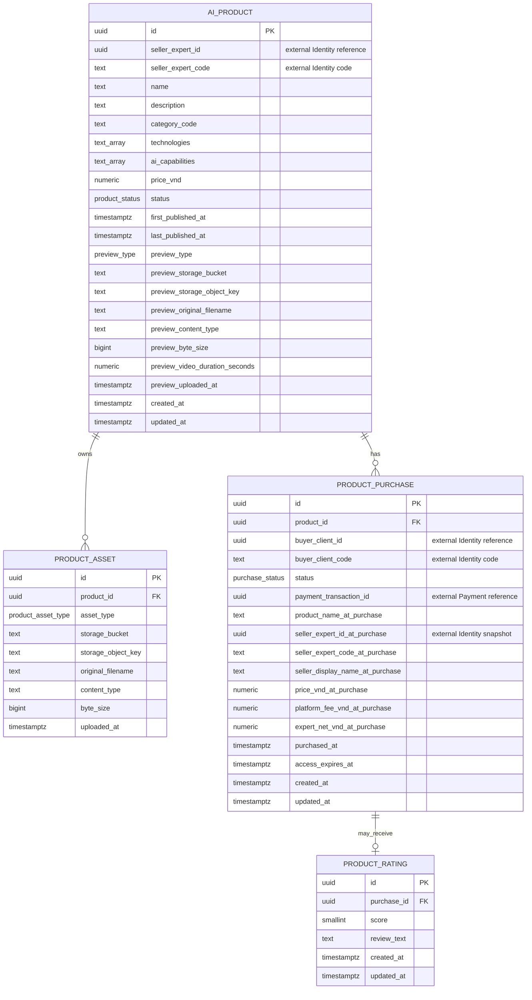

# Approved Phase 3 Review Revisions

This revision incorporates the approved Phase 3 review decisions:

- Product prices may be any positive whole-VND amount; they are **not** required to be divisible by 10.
- Platform fee is `ROUND(price * 10%)` to the nearest whole VND; Expert net is the exact remainder.
- Purchase History does not snapshot Preview Supabase objects.
- Protected storage objects are unique by `(storage_bucket, storage_object_key)`.
- Editing Product basic information/price/preview while `PUBLISHED` is explicitly prohibited at the service layer.
- Buyer Purchase History index is limited to successful Purchases.

# 1. Executive Design Summary

**Proposed database:** `ai_available` (PostgreSQL)

The minimum correct MVP model has **four tables**:

1. `ai_product`
2. `product_asset`
3. `product_purchase`
4. `product_rating`

`ai_product` holds one optional public preview directly as nullable columns. A separate one-to-one preview table would add an identifier, foreign key, and uniqueness constraint without enabling an MVP query or lifecycle that the product row cannot express more simply. Purchase History intentionally does not snapshot the preview storage object.

`product_asset` is a separate table because a product owns four typed, independently uploaded protected objects; `UNIQUE (product_id, asset_type)` both models and enforces the one-per-type rule. `product_purchase` holds the successful-purchase snapshot and the 30-day entitlement fields directly. Therefore, neither a `PurchaseSnapshot` nor an `Entitlement` table is needed for the one-successful-purchase/one-entitlement MVP. `product_rating` references the purchase, which avoids duplicating client and product identifiers and makes ownership eligibility natural.

Money is stored as `numeric(19,2)` to match the verified `payment-service` transaction precision. Every AI Place monetary value is constrained to a whole VND value (`value = trunc(value)`). Product prices are **not** required to be divisible by 10. At successful settlement, the 10% platform fee is rounded to the nearest whole VND and the Expert net amount is the remainder: `expert_net = price - platform_fee`. This preserves whole-VND accounting without restricting valid Product prices.

All Identity and Payment references are scalar external references only. There are **no cross-database foreign keys**.

# 2. Aggregate and Entity Responsibilities

## `ai_product`

- **Purpose:** The AI Place listing aggregate: seller references, searchable product information, price, lifecycle, and the optional public preview.
- **Owner:** `ai-available-service`.
- **Lifecycle responsibility:** Represents `DRAFT -> PUBLISHED -> UNPUBLISHED -> PUBLISHED`; retains `first_published_at` as the permanent evidence that deliverables must remain locked.
- **Why it deserves a table:** It is the independently managed and browsed commercial product. Its status, price, preview, and seller reference are not properties of an asset or a purchase.

## `product_asset`

- **Purpose:** Metadata and durable Supabase object reference for one protected deliverable.
- **Owner:** `ai-available-service`; Supabase owns the actual object bytes.
- **Lifecycle responsibility:** Can be inserted, replaced, or removed only while its parent Product has never been published and is `DRAFT`; is immutable thereafter.
- **Why it deserves a table:** A Product owns exactly four separately addressable objects with a typed uniqueness rule. Four fixed columns on `ai_product` would be harder to validate, upload, and serve consistently.

## `product_purchase`

- **Purpose:** The stable Client/Product purchase intent, then the durable successful purchase history, commercial snapshot, and 30-day download entitlement.
- **Owner:** `ai-available-service`; `payment-service` owns the referenced financial transaction and wallet movements.
- **Lifecycle responsibility:** Starts as `PENDING_PAYMENT`; the same row is retried until it becomes `SUCCESS`. Successful purchase data never changes.
- **Why it deserves a table:** It is a business purchase distinct from a financial transaction and must survive price/listing changes and entitlement expiration.

## `product_rating`

- **Purpose:** A Client's active rating/review of one successful purchase.
- **Owner:** `ai-available-service`.
- **Lifecycle responsibility:** Insert after a successful purchase, edit in place, or hard-delete. No rating/dispute/moderation lifecycle is in MVP.
- **Why it deserves a table:** Ratings are independently listed and aggregated per product. Referencing the purchase enforces the right ownership path without copying the buyer or product IDs.

# 3. Proposed Database Tables

All UUID primary keys use `gen_random_uuid()` (requiring PostgreSQL's `pgcrypto` extension) unless EF Core supplies the UUID before insert. `updated_at` is set by the service on every allowed update; it is not client supplied.

## `ai_product`

| Column | PostgreSQL Type | Nullable | Default | Constraint / Meaning |
|---|---|---:|---|---|
| `id` | `uuid` | No | `gen_random_uuid()` | Primary key. |
| `seller_expert_id` | `uuid` | No | — | External Identity user/expert UUID reference; no cross-service FK. |
| `seller_expert_code` | `text` | No | — | External Identity code used by existing wallet/payment flows, such as `EXP-...`; not an Expert Profile copy. |
| `name` | `text` | No | — | Required product name; `CHECK (btrim(name) <> '')`. |
| `description` | `text` | Yes | — | Draft may be incomplete; when present it cannot be whitespace. A publication trigger/service rule requires a nonblank value before publishing. |
| `category_code` | `text` | No | — | Required application-owned category value; `CHECK (btrim(category_code) <> '')`. No category FK/table. |
| `technologies` | `text[]` | No | `ARRAY[]::text[]` | Unnormalized ordered/set-like list of technology labels. Service normalizes, rejects blanks, and removes duplicates. |
| `ai_capabilities` | `text[]` | No | `ARRAY[]::text[]` | Unnormalized list of AI capability labels, with the same service validation as technologies. |
| `price_vnd` | `numeric(19,2)` | No | — | Fixed live selling price. `CHECK (price_vnd > 0 AND price_vnd = trunc(price_vnd))`. Whole-VND price; no divisibility-by-10 restriction. |
| `status` | `product_status` | No | `'DRAFT'` | Current Product lifecycle status. |
| `first_published_at` | `timestamptz` | Yes | — | Set only by the first successful publish; never cleared. Non-null means protected assets are permanently locked in MVP. |
| `last_published_at` | `timestamptz` | Yes | — | Set each time the Product transitions to `PUBLISHED`; supports default browse order. |
| `preview_type` | `preview_type` | Yes | — | Optional single public preview kind: `IMAGE` or `VIDEO`. |
| `preview_storage_bucket` | `text` | Yes | — | Supabase bucket name for the optional preview object; an object reference, not an entitlement credential. |
| `preview_storage_object_key` | `text` | Yes | — | Durable Supabase object/path identity for the optional preview. |
| `preview_original_filename` | `text` | Yes | — | Original uploaded filename for display/audit. |
| `preview_content_type` | `text` | Yes | — | Validated media content type. |
| `preview_byte_size` | `bigint` | Yes | — | Raw byte count, `CHECK (preview_byte_size >= 0)` when present. |
| `preview_video_duration_seconds` | `numeric(8,3)` | Yes | — | Required only for `VIDEO`; `CHECK (preview_video_duration_seconds > 0 AND preview_video_duration_seconds <= 240.000)`. Must be null for `IMAGE`. |
| `preview_uploaded_at` | `timestamptz` | Yes | — | Upload time of the current preview object. |
| `created_at` | `timestamptz` | No | `now()` | Creation timestamp. |
| `updated_at` | `timestamptz` | No | `now()` | Last permitted Product update timestamp. |

One table-level preview-completeness `CHECK` is required: either `preview_type` and every preview metadata column are all null, or the common object metadata is all non-null; a video has a duration in `(0, 240]` and an image has no duration. Since the preview is represented by one column group, maximum one preview is structurally guaranteed.

A lifecycle-shape `CHECK` requires Draft rows to have both publication timestamps null and Published/Unpublished rows to have both timestamps non-null with `last_published_at >= first_published_at`. The transition trigger, rather than a client value, supplies those timestamps.

## `product_asset`

| Column | PostgreSQL Type | Nullable | Default | Constraint / Meaning |
|---|---|---:|---|---|
| `id` | `uuid` | No | `gen_random_uuid()` | Primary key. |
| `product_id` | `uuid` | No | — | Internal FK to `ai_product(id) ON DELETE CASCADE`. Cascade is reachable only for an allowed never-published Draft delete. |
| `asset_type` | `product_asset_type` | No | — | One of the four protected deliverable types. |
| `storage_bucket` | `text` | No | — | Supabase bucket containing the protected object. |
| `storage_object_key` | `text` | No | — | Durable object/path reference. It is never a permanent public-URL entitlement. |
| `original_filename` | `text` | No | — | Original filename for download presentation/audit. |
| `content_type` | `text` | No | — | Validated media type, not merely a browser display hint. |
| `byte_size` | `bigint` | No | — | Raw byte count; `CHECK (byte_size >= 0)`. |
| `uploaded_at` | `timestamptz` | No | `now()` | Time the current draft asset object was recorded. |

Constraints: primary key, `UNIQUE (product_id, asset_type)`, and `UNIQUE (storage_bucket, storage_object_key)`. The storage-object uniqueness rule prevents one protected Supabase object from being attached to multiple ProductAsset rows. A database trigger consults the parent Product's `first_published_at` and rejects any asset insert, update, or delete once it is non-null.

## `product_purchase`

| Column | PostgreSQL Type | Nullable | Default | Constraint / Meaning |
|---|---|---:|---|---|
| `id` | `uuid` | No | `gen_random_uuid()` | Primary key and stable payment correlation/idempotency reference. |
| `product_id` | `uuid` | No | — | Internal FK to `ai_product(id) ON DELETE RESTRICT`. |
| `buyer_client_id` | `uuid` | No | — | External Identity UUID for the Client; no cross-service FK. |
| `buyer_client_code` | `text` | No | — | External Client code required by existing wallet/payment conventions; not a User/Profile copy. |
| `status` | `purchase_status` | No | `'PENDING_PAYMENT'` | Stable intent state: pending payment or successfully owned. |
| `payment_transaction_id` | `uuid` | Yes | — | External `payment-service` main settlement transaction ID; no FK. Unique when present. Payment-service retains any internal fee transaction(s). |
| `product_name_at_purchase` | `text` | Yes | — | Immutable successful-purchase listing title. Required for `SUCCESS`. |
| `seller_expert_id_at_purchase` | `uuid` | Yes | — | Immutable seller Identity UUID snapshot. Required for `SUCCESS`; no external FK. |
| `seller_expert_code_at_purchase` | `text` | Yes | — | Immutable seller external-code snapshot. Required for `SUCCESS`. |
| `seller_display_name_at_purchase` | `text` | Yes | — | Minimal Identity display-name snapshot for history. Required for `SUCCESS`; not a full Expert Profile copy. |
| `price_vnd_at_purchase` | `numeric(19,2)` | Yes | — | Immutable successful-purchase gross price. Required for `SUCCESS`, whole VND. |
| `platform_fee_vnd_at_purchase` | `numeric(19,2)` | Yes | — | Immutable 10% platform share. Required for `SUCCESS`, whole VND. |
| `expert_net_vnd_at_purchase` | `numeric(19,2)` | Yes | — | Immutable 90% Expert share. Required for `SUCCESS`, whole VND. |
| `purchased_at` | `timestamptz` | Yes | — | Success time. Required for `SUCCESS`. |
| `access_expires_at` | `timestamptz` | Yes | — | Required for `SUCCESS`; exactly `purchased_at + interval '30 days'`. |
| `created_at` | `timestamptz` | No | `now()` | Creation time of the stable Purchase intent. |
| `updated_at` | `timestamptz` | No | `now()` | Last pending-to-success transition/update time. |

`UNIQUE (product_id, buyer_client_id)` gives one permanent stable Purchase row for a Client/Product pair. `UNIQUE (payment_transaction_id)` permits multiple nulls in PostgreSQL but prevents any payment transaction ID from being attached to two Purchases.

A status-dependent `CHECK` requires every payment, snapshot, and entitlement column to be null for `PENDING_PAYMENT`; it requires the payment transaction ID, core snapshots, monetary snapshots, `purchased_at`, and `access_expires_at` for `SUCCESS`. It also enforces whole-VND snapshots, `platform_fee_vnd_at_purchase = round(price_vnd_at_purchase * 0.10, 0)`, `expert_net_vnd_at_purchase = price_vnd_at_purchase - platform_fee_vnd_at_purchase`, and the exact 30-day expiry.

## `product_rating`

| Column | PostgreSQL Type | Nullable | Default | Constraint / Meaning |
|---|---|---:|---|---|
| `id` | `uuid` | No | `gen_random_uuid()` | Primary key. |
| `purchase_id` | `uuid` | No | — | Internal FK to `product_purchase(id) ON DELETE RESTRICT`; derives both Client and Product. |
| `score` | `smallint` | No | — | Integer star score; `CHECK (score BETWEEN 1 AND 5)`. |
| `review_text` | `text` | Yes | — | Optional written review; when present `CHECK (btrim(review_text) <> '')`. |
| `created_at` | `timestamptz` | No | `now()` | Rating creation time. |
| `updated_at` | `timestamptz` | No | `now()` | Last rating edit time. |

`UNIQUE (purchase_id)` means one active rating per successful Purchase. Hard deletion removes the row and permits that purchaser to create a new active rating later.

# 4. Enum / Value Domains

Use PostgreSQL named enum types (and map them explicitly in the future EF Core/Npgsql model), rather than unconstrained status strings.

| Domain | Values | Notes |
|---|---|---|
| `product_status` | `DRAFT`, `PUBLISHED`, `UNPUBLISHED` | Only valid state transitions are enforced by service and a database transition trigger. |
| `product_asset_type` | `SOURCE_CODE`, `VIDEO`, `DATASET`, `DOCUMENT` | These are protected deliverable types only; a public preview is not an asset row. |
| `preview_type` | `IMAGE`, `VIDEO` | Optional Product/History-preview type. |
| `purchase_status` | `PENDING_PAYMENT`, `SUCCESS` | Deliberately no `FAILED` state: insufficient balance and retryable payment failures retain the single pending intent. |

No `currency` enum/column is needed: AI Place is VND-only. `category_code` is deliberately a required text value, not a database enum, because the authoritative materials do not define the category vocabulary. It can evolve through application validation without a database enum migration.

# 5. Relationships

- `ai_product 1 -> 0..4 product_asset`: a Product owns at most one protected asset for each of the four fixed types. The publication rule makes four assets mandatory before a Product enters `PUBLISHED`.
- `ai_product 1 -> 0..N product_purchase`: a Product can have many purchase intents/successful buyers over time.
- `product_purchase 1 -> 0..1 product_rating`: a successful purchase may have one active rating; rating deletion returns it to zero.
- `ai_product.seller_expert_id`, `ai_product.seller_expert_code`, `product_purchase.buyer_client_id`, `product_purchase.buyer_client_code`, seller snapshot fields, and `product_purchase.payment_transaction_id` are external scalar references. They have no relationship/FK in this database.

# 6. Business Invariants & Enforcement Matrix

| Business Rule | DB / Service / Both | Enforcement Design | Reason |
|---|---|---|---|
| Product name is required | DB | `NOT NULL` plus nonblank `CHECK`; service trims/normalizes input. | A single-row invariant is safe and useful in the database. |
| Full description exists before Publish | Both | Service validates it before transition; `BEFORE ... PUBLISHED` trigger rejects null/blank description. | It is intentionally allowed to be incomplete in Draft but must be race-safe at Publish. |
| Price is positive and whole VND | DB | `numeric(19,2)` checks for `> 0` and no fractional VND. | Avoids floating point while allowing any valid whole-VND Product price. |
| Platform fee uses the agreed rounded 10% policy | Both | Service calculates `round(price * 0.10, 0)` at successful settlement; successful Purchase checks require the stored fee to match that rounded value and Expert net to equal the remainder. | Keeps fee policy explicit and prevents snapshot totals from drifting. |
| Product seller is an active Expert | Service | Authenticate caller and use Identity gRPC role/status lookup before creation or seller-sensitive actions. | Role/status are owned by `identity-service`. |
| Only a never-published Draft may be hard-deleted by its Expert | Both | Service authorizes owner and locks row; `BEFORE DELETE` trigger requires `status = DRAFT` and `first_published_at IS NULL`. | The prior state cannot be represented by a normal row check. |
| Product status follows only Draft/Published/Unpublished lifecycle | Both | Service state machine; database transition validation permits only `DRAFT->PUBLISHED`, `PUBLISHED->UNPUBLISHED`, and `UNPUBLISHED->PUBLISHED`. | Enum alone cannot validate the old-to-new transition. |
| Basic Product metadata, price, and preview cannot be edited while `PUBLISHED` | Service | Update commands require the Product to be `DRAFT` or `UNPUBLISHED`; Expert must Unpublish before editing a live listing. | This is an application workflow rule and does not need a broad database trigger over every editable column. |
| Exactly four protected deliverable types exist before every Publish | Both | Service prevalidates four distinct required types; publication trigger verifies exactly one of every `product_asset_type`. | Aggregate count/type check spans rows. |
| One protected asset per Product/type | Both | `UNIQUE (product_id, asset_type)`; service returns a replace/remove workflow only in Draft. | DB prevents concurrent duplicates; service provides behavior. |
| Protected assets are immutable after first Publish | Both | Service rejects asset operations once `first_published_at` exists; asset mutation trigger rejects insert/update/delete for that parent. | Unpublish must not unlock assets, including through direct data access. |
| Preview is optional and maximum one | DB | One nullable preview column group on `ai_product` with all-or-none check. | One physical slot makes a separate uniqueness rule unnecessary. |
| Preview video is at most 240 seconds | Both | Service measures/validates trusted media metadata; database check bounds persisted duration to `<= 240.000`. | DB preserves the fact; service must not trust browser-supplied duration. |
| Only Client may create/retry a Purchase | Service | Current Identity role must be `CLIENT`. | Roles live in `identity-service`. |
| Client cannot purchase own Product | Service | Compare authenticated Client UUID with `seller_expert_id` on the locked Product. | This cross-row identity rule depends on external actor identity. |
| Only PUBLISHED Product is purchasable | Service | Lock Purchase/Product, re-read current status immediately before settlement, and reject Draft/Unpublished Products. | Purchasability is a workflow/action rule, not static row shape. |
| One stable Purchase record per Client/Product | Both | `UNIQUE (product_id, buyer_client_id)`; service returns/reuses the existing pending row instead of inserting an attempt row. | The DB removes duplicate/race paths; service implements retry semantics. |
| Pending payment grants no ownership | Both | Pending-status check leaves payment/snapshot/entitlement fields null; download authorization requires `SUCCESS` and unexpired access. | Both persistence shape and access decision matter. |
| A payment transaction reference cannot map to multiple successful Purchases | Both | `UNIQUE (payment_transaction_id)` plus `SUCCESS` requires it; service accepts only the settlement reference returned for the locked Purchase correlation ID. | Neither a duplicate callback nor a bad mapping may create double ownership. |
| `access_expires_at` is exactly 30 days after purchase | Both | Service computes from success time; `SUCCESS` check enforces `access_expires_at = purchased_at + interval '30 days'`. | Avoids client-calculated entitlement time. |
| Successful snapshot is complete and immutable | Both | Status-dependent checks require snapshots at `SUCCESS`; a purchase trigger allows only `PENDING_PAYMENT->SUCCESS` and rejects later snapshot/payment/status changes. | Historical record must survive live Product edits and duplicate callbacks. |
| Price changes before payment use current price | Service | Pending rows contain no commercial snapshot. Each settlement attempt locks/revalidates the Product and uses its current price; success writes that exact snapshot. | Avoids a stale intent price becoming historical ownership. |
| Existing buyers retain entitlement after Unpublish | Service | Download authorization is based on Purchase success/expiry, never Product current status. | Unpublish affects discovery/new purchases, not previously granted access. |
| Only a successful purchaser can rate | Both | Service authorizes caller as the derived Purchase buyer; rating eligibility trigger requires referenced Purchase status `SUCCESS`. | FK alone would otherwise allow a pending Purchase rating. |
| One active rating per Client/Product | Both | `UNIQUE (purchase_id)` and Product/Client uniqueness derive one active rating per pair; service exposes only caller-owned rating actions. | Avoids redundant `client_id`/`product_id` in Rating. |
| Rating score is 1–5 | DB | `smallint CHECK (score BETWEEN 1 AND 5)`. | Stable scalar domain. |
| Rating edit/delete belongs only to buyer | Service | Resolve `purchase_id` and compare its buyer UUID with authenticated Client; hard delete is allowed. | Database has no current-request principal. |

# 7. Product Publication & Deliverable Locking

1. **Draft:** Create `ai_product` with `status = DRAFT` and `first_published_at = NULL`. The Expert may edit its basic information, price, preview, and its `product_asset` rows. A replace can update the one row for that asset type or remove/recreate it; the unique constraint remains satisfied.
2. **First Publish:** In one service transaction, lock the Product, verify owner/Expert role, require description and all four protected types, then set `status = PUBLISHED`, `first_published_at = now()`, and `last_published_at = now()`. The database publication trigger repeats the row-spanning validation. No Product Version row is created.
3. **Locked state:** As soon as `first_published_at` is non-null, the asset mutation trigger blocks every protected asset insert, update, and delete. This remains true regardless of current status. Basic listing edits are allowed only while Draft or Unpublished; a Published Product is unlisted first before basic information/price/preview changes.
4. **Unpublish:** Transition only `PUBLISHED -> UNPUBLISHED`. The listing leaves discovery/new-purchase queries, but its assets remain locked and existing successful Purchases still authorize access until expiry.
5. **Republish:** Revalidate the unchanged four assets and required publish fields, transition `UNPUBLISHED -> PUBLISHED`, and update `last_published_at`. `first_published_at` is never overwritten or cleared.

The Expert-delete trigger permits a hard delete only if the Product is still Draft and `first_published_at` is null. Its draft-only assets then cascade-delete. A published-at-least-once Product cannot be hard-deleted by the Expert in MVP.

# 8. Purchase / Payment / Retry Model

`product_purchase.id` is the stable Purchase Intent ID and the future payment-service correlation/idempotency key.

1. A verified Client requests purchase of a currently `PUBLISHED` Product that they do not own. The service inserts one `PENDING_PAYMENT` row with only Product/Client references. The unique Client/Product constraint means a repeated request returns that same row, rather than creating a new failed/attempt row.
2. For every settlement attempt, the service locks the pending Purchase and Product, rechecks Client/owner/purchasability, and reads the current Product price. A pending row deliberately has no frozen commercial snapshot.
3. If wallet balance is insufficient, the Client follows the existing top-up flow. No `FAILED` Purchase row is inserted and the existing row remains `PENDING_PAYMENT`.
4. The retry submits the same `product_purchase.id` to the future narrowly scoped payment settlement contract. That contract must treat the ID as its idempotency/correlation reference.
5. Once the payment-service reports the correlated settlement successful, the service transitions the existing row exactly once to `SUCCESS`, sets the returned main `payment_transaction_id`, writes the current commercial/listing snapshots, sets `purchased_at`, and derives `access_expires_at`.

The payment request is made with the locked current price and seller code. A Product that is no longer `PUBLISHED` is rejected before retry settlement; it does not become a successful purchase merely because an old pending intent exists. A robust later implementation must reconcile a remote settlement response using this same Purchase ID if a local persistence failure occurs after a payment call; that is why the correlation field is first-class here. This design does not prescribe the Payment API or its financial transaction rows.

# 9. Purchase Snapshot Strategy

A separate `PurchaseSnapshot` table has no benefit in MVP because a Purchase has exactly one terminal successful snapshot and no snapshot collection/version lifecycle. The following `product_purchase` columns are written only during the `PENDING_PAYMENT -> SUCCESS` transition and are then immutable:

- `product_name_at_purchase`
- `seller_expert_id_at_purchase`, `seller_expert_code_at_purchase`, and `seller_display_name_at_purchase`
- `price_vnd_at_purchase`, `platform_fee_vnd_at_purchase`, and `expert_net_vnd_at_purchase`
- `payment_transaction_id`, `purchased_at`, and `access_expires_at`

The public Preview is deliberately **not** snapshotted into Purchase History. It is marketing media, not a purchased deliverable, and snapshotting its Supabase object would force indefinite retention of old preview objects after Experts update them. Purchase History may use a generic/default UI image if the live Product preview later changes or disappears.

Protected assets need no per-Purchase snapshot because they become immutable before the first sale. Successful snapshot fields are frozen after the `PENDING_PAYMENT -> SUCCESS` transition; Product updates cannot alter historical commercial data.

# 10. Entitlement Strategy

No separate `Entitlement` table is needed. The MVP relationship is exactly one successful Purchase to one non-renewable 30-day access period, so `product_purchase.status`, `purchased_at`, and `access_expires_at` are the entitlement record.

At protected-download request time, the service verifies all of the following:

```text
purchase.product_id = requested product
AND purchase.buyer_client_id = current authenticated Client
AND purchase.status = SUCCESS
AND current time < purchase.access_expires_at
```

The service then may issue temporary/protected Supabase access for the selected `product_asset`. It does not return a durable protected URL as proof of entitlement. Expiry removes download access but not Purchase History, ownership history, or the Client/Product uniqueness record. Product unpublish is deliberately absent from this authorization check.

# 11. Rating Strategy

`product_rating.purchase_id` points to the single purchase that grants eligibility. The service verifies that the current Client is that Purchase's `buyer_client_id`; a database trigger also rejects a Rating whose referenced Purchase is not `SUCCESS`. Entitlement expiration does not remove rating eligibility: the rule is successful purchase, not recent download/use.

`UNIQUE (purchase_id)` gives one active rating for the one Client/Product purchase. The Client may update `score` and optional `review_text` in place. Hard deletion removes the active row and is acceptable in MVP. Scores use whole integer stars from 1 through 5; fractional stars are not established by the source material and are intentionally not introduced.

Product rating list and average are read from `product_rating` joined through `product_purchase` to `product_id`. Calculate `AVG(score)` at query time; do not store a denormalized average/count that would need synchronization after edits/deletes.

# 12. Search / Filter Storage Strategy

- **Category:** Store a required `category_code text` in `ai_product`. A Category table would have no owner, metadata, administration flow, or MVP relationship beyond a single filter value. The client/service must use an agreed canonical code list.
- **Technologies and AI capabilities:** Store each as `text[]`. The MVP only displays/saves these labels; it does not filter, administer, or relate across them. Relational Technology/Capability join tables would be over-normalization.
- **Keyword/name:** Use a parameterized case-insensitive name match (for example, `name ILIKE '%' || :keyword || '%'`) over published Products. The MVP does not require PostgreSQL full-text search or `pg_trgm`; for an initially modest catalog, a simple filter is the smallest correct design. Add a measured full-text/trigram index only if catalog size and query profiling justify it.
- **Category and price range:** Use `category_code` and `price_vnd` on the Product row. The partial published indexes below support normal browse/filter combinations without exposing Draft or Unpublished listings.

# 13. Indexes and Unique Constraints

Primary keys and the unique constraints below create their usual supporting indexes. The explicit non-unique indexes are limited to the stated MVP reads.

| Table | Index / Constraint | Columns | Purpose |
|---|---|---|---|
| `ai_product` | `pk_ai_product` | `id` | Primary key. |
| `ai_product` | `ix_ai_product_published_recent` | `last_published_at DESC, id` with `WHERE status = 'PUBLISHED'` | Default public browse order. |
| `ai_product` | `ix_ai_product_published_category_price` | `category_code, price_vnd, id` with `WHERE status = 'PUBLISHED'` | Published category filter plus price range. |
| `ai_product` | `ix_ai_product_published_price` | `price_vnd, id` with `WHERE status = 'PUBLISHED'` | Published price-only range filter. |
| `ai_product` | `ix_ai_product_seller_updated` | `seller_expert_id, updated_at DESC, id` | Expert's own Product list. |
| `product_asset` | `pk_product_asset` | `id` | Primary key. |
| `product_asset` | `uq_product_asset_product_type` | `product_id, asset_type` | Exactly one protected asset of each type; also serves Product asset lookup. |
| `product_asset` | `uq_product_asset_storage_object` | `storage_bucket, storage_object_key` | One protected Supabase object belongs to only one ProductAsset row. |
| `product_purchase` | `pk_product_purchase` | `id` | Stable purchase/correlation identity. |
| `product_purchase` | `uq_product_purchase_product_buyer` | `product_id, buyer_client_id` | One stable intent/ownership record per Client/Product; entitlement lookup by Client/Product. |
| `product_purchase` | `uq_product_purchase_payment_transaction` | `payment_transaction_id` | A payment transaction reference cannot attach to multiple Purchases; PostgreSQL permits multiple nulls. |
| `product_purchase` | `ix_product_purchase_buyer_history` | `buyer_client_id, purchased_at DESC, id` with `WHERE status = 'SUCCESS'` | Client Purchase History contains successful ownership records only, including expired entitlements. |
| `product_rating` | `pk_product_rating` | `id` | Primary key. |
| `product_rating` | `uq_product_rating_purchase` | `purchase_id` | One active rating per successful Purchase; supports current Client rating lookup after Purchase lookup. |

The product/buyer uniqueness index begins with `product_id`, so it also supports the join path used for Product rating lists/averages. No redundant `product_id` or `buyer_client_id` index is added to `product_rating` because those values are deliberately derived from its Purchase.

# 14. Final Mermaid ERD



# 15. Example Record Walkthrough

1. Expert `EXP-701` creates `ai_product` `P1` as `DRAFT`, with price `1,000,000.00`, no preview initially, and `first_published_at = NULL`.
2. The Expert uploads a source archive, full video, dataset, and document. Four `product_asset` rows are created for `P1`, one for each `product_asset_type`, with Supabase bucket/object keys and raw byte sizes.
3. Publish validation succeeds. `P1.status` becomes `PUBLISHED`; both publication timestamp columns become `T1`. The assets are now permanently locked.
4. Client `CLI-220` requests purchase. One `product_purchase` row `PU1` is created with `product_id = P1`, that Client's UUID/code, and `status = PENDING_PAYMENT`; all snapshot/payment/entitlement fields remain null.
5. Wallet balance is insufficient. The Client tops up through the existing flow. `PU1` is unchanged—there is no failed Purchase row. The retry uses `PU1` as payment correlation ID.
6. Payment settlement succeeds and returns main transaction UUID `PT1`. `PU1` updates once to `SUCCESS`, stores `PT1`, the title/seller snapshots, gross `1,000,000.00`, platform fee `100,000.00`, Expert net `900,000.00`, `purchased_at = T2`, and `access_expires_at = T2 + 30 days`.
7. Until expiry, `PU1` authorizes unlimited protected-download requests for `P1`'s four unchanged `product_asset` rows. It continues to appear in history after expiry.
8. The Client rates the product. One `product_rating` row `R1` is inserted with `purchase_id = PU1` and score `5`. A later edit updates `R1`; delete hard-removes `R1`.

# 16. Avoided / Deferred Entities

| Avoided / Deferred Item | Why it is not an MVP table/entity |
|---|---|
| `ProductVersion` | First-published deliverables are immutable; changing them requires versioning and is explicitly out of scope. |
| `ProductPreview` | One optional preview has no independent lifecycle/query beyond its Product, so nullable Product columns are simpler. |
| `Entitlement` | One successful Purchase always creates one fixed 30-day entitlement, fully represented by two Purchase timestamps and status. |
| `PurchaseSnapshot` | One terminal immutable snapshot belongs one-to-one to a Purchase; columns avoid a table/join with no benefit. |
| `Category` | No authoritative category metadata, ownership flow, or management use case is in MVP; `category_code` is sufficient. |
| `Technology` / `Capability` | MVP saves/displays lists but does not manage or query a taxonomy; `text[]` is sufficient. |
| `Report` / `Dispute` | Explicitly out of scope. |
| Refund, escrow, subscription, license marketplace | Payment is immediate 90/10 digital-product settlement; these are explicitly excluded. |
| Expert Rating | Owned by existing `rate-service` and unrelated to Product Rating. |
| Workspace, JobPost, Product download log | No ownership or MVP requirement. Downloads are unlimited within entitlement; logging is not required for authorization. |

# 17. Open Decisions / Risks

1. **Payment-service extension remains a prerequisite for implementation, not for this ERD.** The Phase 2 audit verified that existing generic transaction creation is not wallet settlement, and current payment enums do not include an AI Product reference/type. Before Phase 4, the new settlement contract must accept `product_purchase.id` as an idempotency/correlation value and reliably return/reconcile a main payment transaction UUID.
2. **The canonical category vocabulary is not defined in the authoritative materials.** This design safely stores a nonblank `category_code`; Product/API work must agree the permitted codes and validation source before implementation.
3. **Supabase private-bucket/path ownership proof and object cleanup policy remain an integration decision.** The ERD stores durable bucket/object keys and metadata, but the existing frontend audit does not establish private bucket policy, signed-access behavior, or orphan cleanup after a Draft replacement/removal. These must be resolved when upload/download flows are implemented.

There is no blocker to approving this database/ERD design itself.
