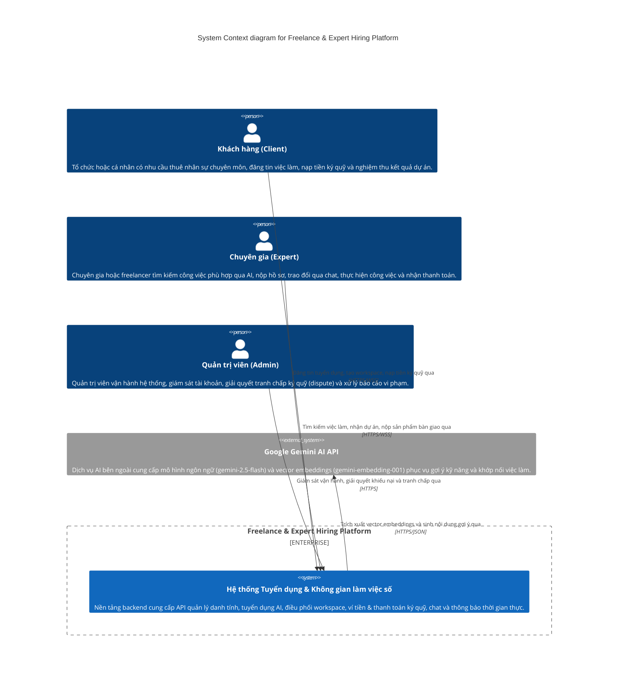

# Level 1 — System Context — Freelance & Expert Hiring Platform

> **Diagram type**: System Context (`C4Context`)
> **Scope**: Toàn bộ hệ thống Freelance & Expert Hiring Platform trong mối tương quan với các nhóm người dùng và hệ thống bên ngoài.
> **Audience**: Các bên liên quan (Kỹ thuật và Phi kỹ thuật), Product Owner, Solution Architect, Developers mới gia nhập dự án.

## Overview

Freelance & Expert Hiring Platform là một hệ sinh thái tuyển dụng và làm việc trực tuyến theo mô hình Microservices, kết nối giữa Khách hàng (Client) có nhu cầu thuê chuyên gia và các Chuyên gia (Expert/Freelancer) cung cấp dịch vụ chuyên môn. Hệ thống không chỉ hỗ trợ đăng tin tuyển dụng truyền thống mà còn tích hợp trí tuệ nhân tạo (AI Matching) qua vector embeddings, hỗ trợ điều phối không gian làm việc số (Workspace Orchestration), giao tiếp thời gian thực (Chat/Notification) và cơ chế thanh toán ký quỹ an toàn (Project Escrow).

Sơ đồ System Context thể hiện ranh giới hệ thống ở mức nhìn tổng quát nhất từ bên ngoài, chỉ rõ ai là người tương tác và hệ thống phụ thuộc vào những dịch vụ bên ngoài nào mà không đi sâu vào chi tiết công nghệ nội bộ.

## Diagram

## Legend

- **Person / Actor**: Người dùng thực tế tương tác với hệ thống (Client, Expert, Admin).
- **System (in scope)**: Hệ thống Freelance & Expert Hiring Platform — trọng tâm thiết kế và vận hành của dự án.
- **External System**: Hệ thống bên ngoài phạm vi kiểm soát trực tiếp của dự án mà backend tích hợp (Google Gemini AI API).

## Elements

| Element | Type | Technology | Responsibility |
|---|---|---|---|
| Khách hàng (Client) | Person | Trình duyệt Web | Đăng tuyển công việc, duyệt ứng viên, tạo hợp đồng workspace, nạp tiền ký quỹ (escrow) và đánh giá sau khi hoàn thành. |
| Chuyên gia (Expert) | Person | Trình duyệt Web | Xây dựng hồ sơ năng lực, tìm việc theo kỹ năng phù hợp, nộp hồ sơ, trao đổi trực tiếp và bàn giao sản phẩm trong workspace. |
| Quản trị viên (Admin) | Person | Trình duyệt Web | Vận hành toàn hệ thống, kiểm duyệt nội dung báo cáo vi phạm, làm trọng tài phân giải tranh chấp khi có mâu thuẫn giải ngân. |
| Freelance & Expert Hiring Platform | System (in scope) | Microservices (Java Spring Boot, .NET 8, PostgreSQL, Kafka, Redis) | Cung cấp đầy đủ nghiệp vụ quản lý tài khoản, khớp nối việc làm, điều phối tiến độ công việc, giữ tiền ký quỹ và giao tiếp thời gian thực. |
| Google Gemini AI API | System_Ext | REST API (Google Generative Language) | Nhận dữ liệu mô tả kỹ năng và tin tuyển dụng để chuyển đổi thành vector 1536 chiều và hỗ trợ phân tích gợi ý thông minh. |

## Key relationships

| From | To | Intent | Protocol / Technology |
|---|---|---|---|
| Khách hàng (Client) | Freelance & Expert Platform | Đăng việc, nạp tiền ký quỹ, quản lý tiến độ và đánh giá chuyên gia | HTTPS / WSS |
| Chuyên gia (Expert) | Freelance & Expert Platform | Nhận gợi ý việc làm, gửi báo cáo tiến độ, nộp sản phẩm và rút tiền | HTTPS / WSS |
| Quản trị viên (Admin) | Freelance & Expert Platform | Kiểm tra nhật ký hệ thống, can thiệp phân xử tranh chấp dự án | HTTPS |
| Freelance & Expert Platform | Google Gemini AI API | Sinh vector embeddings và gợi ý kỹ năng phù hợp qua API | HTTPS/JSON |

## Notable architectural decisions

- **Tách biệt rõ 3 vai trò người dùng (Client, Expert, Admin)**: Kiểm chứng qua `Role.java` (`EXPERT`, `ADMIN`, `CLIENT`). Mỗi vai trò có luồng công việc và trách nhiệm rõ ràng trên nền tảng.
- **Tích hợp Generative AI làm tính năng cốt lõi**: Khác với các hệ thống tuyển dụng thuần CRUD, hệ thống tích hợp trực tiếp Google Gemini AI API để hỗ trợ semantic search và gợi ý năng lực chuyên gia bằng vector similarity.
- **Cơ chế Escrow bảo vệ dòng tiền**: Giữ tiền tạm thời của Client trong quá trình Expert thực hiện dự án và chỉ giải ngân khi hai bên đồng thuận hoặc Admin giải quyết tranh chấp.

## Assumptions

- **Kênh thông báo email**: File cấu hình mẫu `.env` và `README.md` có chứa biến SMTP (`MAIL_USERNAME`, `MAIL_PASSWORD`), tuy nhiên qua rà soát source code của `notification-service` hiện tại, hệ thống mới chỉ cài đặt thông báo thời gian thực qua SignalR WebSocket và lưu cơ sở dữ liệu. Giả định luồng gửi email qua SMTP đang trong kế hoạch nâng cấp hoặc sẽ tích hợp thêm worker ngoài.
- **Cổng thanh toán bên thứ ba (VNPay, MoMo, Stripe)**: Hiện tại `payment-service` mới triển khai mô hình ví nội bộ (`UserWallet`) và ký quỹ (`ProjectEscrow`), chưa thấy cấu hình SDK của cổng thanh toán ngoài; giả định các giao dịch nạp tiền từ ngân hàng bên ngoài được mô phỏng hoặc xử lý ở giai đoạn sau.

## Links to other levels

- ↓ [Level 2 — Container diagram](./02-container.md) — Chi tiết các ứng dụng, microservices, database và message broker cấu thành hệ thống.
