# Level 2 — Container — Freelance & Expert Hiring Platform

> **Diagram type**: Container (`C4Container`)
> **Scope**: Chi tiết các ứng dụng, tiến trình runtime độc lập, kho lưu trữ dữ liệu và hệ thống thông điệp cấu thành nền tảng Backend.
> **Audience**: Nhóm kỹ thuật — Backend Developers, DevOps, Solution Architects, Kỹ sư kiểm thử.

## Overview

Hệ thống được thiết kế theo kiến trúc **Polyglot Microservices** phân tán, kết hợp giữa hệ sinh thái **Java 21 (Spring Boot 3)** và **.NET 8 (ASP.NET Core)**. Các dịch vụ được đóng gói thành các container độc lập và điều phối tập trung qua Docker Compose.

- **Cổng giao tiếp tập trung**: Mọi yêu cầu từ ứng dụng Web (Single-Page App) từ phía người dùng đều đi qua `API Gateway` (Port 8080). Gateway phối hợp cùng `Service Discovery (Eureka)` để tự động định tuyến động đến các microservice mà không cần khai báo route tĩnh thủ công.
- **Giao tiếp đồng bộ hiệu năng cao (Sync RPC)**: Các service trao đổi dữ liệu nội bộ trực tiếp qua **gRPC** trên nền giao thức Protobuf (HTTP/2), giúp giảm thiểu độ trễ và tối ưu băng thông (ví dụ: Workspace truy vấn Profile từ Identity hoặc kiểm tra trạng thái Escrow từ Payment).
- **Giao tiếp bất đồng bộ hướng sự kiện (Async Event-driven)**: Sử dụng **Apache Kafka** để truyền tải các sự kiện vòng đời dự án (`workspace-events`, `chat-control-events`) và sự kiện thông báo (`notification-events`) đến `Notification Service` nhằm đẩy thông báo thời gian thực tới người dùng.
- **Quản lý dữ liệu (Database per Service)**: Sử dụng phiên bản **PostgreSQL 15** tích hợp extension `pgvector`. Mỗi microservice sở hữu một schema/database riêng biệt nhằm đảm bảo tính độc lập dữ liệu, đồng thời hỗ trợ tìm kiếm vector tương đồng (HNSW cosine similarity) cho tính năng gợi ý kỹ năng AI.

## Diagram

```mermaid
C4Container
    title Container diagram for Freelance & Expert Hiring Platform

    Person(client, "Khách hàng (Client)", "Khách hàng đăng tin tuyển dụng, nạp tiền ký quỹ và nghiệm thu dự án.")
    Person(expert, "Chuyên gia (Expert)", "Chuyên gia tìm kiếm việc làm, nhận dự án, làm việc và nhận thù lao.")
    Person(admin, "Quản trị viên (Admin)", "Quản trị viên hệ thống, giám sát vận hành và giải quyết tranh chấp.")

    System_Boundary(platform_boundary, "Freelance & Expert Hiring Platform") {
        Container(spa, "Web Application (Frontend)", "React / Next.js / TypeScript", "Giao diện Web tương tác trên trình duyệt của người dùng (chạy trên port 3000).")

        Container(gateway, "API Gateway", "Java 21, Spring Cloud Gateway", "Điểm tiếp nhận tập trung (Port 8080), xử lý CORS, định tuyến động qua Eureka, xác thực shared-secret.")
        Container(discovery, "Service Discovery", "Java 21, Spring Cloud Eureka", "Máy chủ đăng ký và phát hiện dịch vụ (Port 8761), kiểm tra trạng thái sống (heartbeat) của các container.")

        Container(identity_svc, "Identity Service", "Java 21, Spring Boot 3, Spring AI", "Quản lý xác thực JWT, phân quyền tài khoản (Client/Expert/Admin), hồ sơ năng lực và vector kỹ năng (Port 4561, gRPC 9091).")
        Container(jobpost_svc, "JobPost Service", "Java 21, Spring Boot 3, Spring AI", "Quản lý bài đăng tuyển dụng, yêu cầu công việc và tìm kiếm ngữ nghĩa với vector embeddings (Port 4562, gRPC 9094).")
        Container(workspace_svc, "Workspace Service", "Java 21, Spring Boot 3", "Điều phối không gian làm việc số, theo dõi tiến độ công việc, nộp sản phẩm bàn giao (Port 8083, gRPC 9093).")
        Container(payment_svc, "Payment Service", "Java 21, Spring Boot 3", "Quản lý ví người dùng (User Wallet), giao dịch nạp/rút và cơ chế ký quỹ an toàn (Project Escrow) (Port 4564, gRPC 9095).")
        Container(chat_svc, "Chat Service", "Java 21, Spring Boot 3, WebSocket", "Quản lý các phòng chat dự án, lưu trữ và truyền nhận tin nhắn trực tiếp giữa Client và Expert (Port 4565, gRPC 9096).")
        Container(notification_svc, "Notification Service", "C#, .NET 8, SignalR", "Tiếp nhận sự kiện từ Kafka, quản lý thông báo người dùng và đẩy thông báo thời gian thực qua SignalR (Port 8086).")
        Container(rate_svc, "Rate Service", "Java 21, Spring Boot 3", "Quản lý đánh giá số sao và nhận xét phản hồi uy tín giữa Client và Expert sau dự án (Port 8087, gRPC 9097).")
        Container(report_svc, "Report Service", "Java 21, Spring Boot 3", "Tiếp nhận khiếu nại, báo cáo vi phạm nội quy và hỗ trợ Admin phân xử tranh chấp (Port 8088).")

        ContainerDb(postgres, "PostgreSQL Database", "PostgreSQL 15 (pgvector)", "Hệ quản trị CSDL quan hệ lưu trữ dữ liệu cho từng service riêng biệt (8 databases) và lưu vector embeddings HNSW.")
        ContainerQueue(kafka, "Apache Kafka Message Broker", "Confluent Kafka 7.5.0 + Zookeeper", "Hàng đợi thông điệp hướng sự kiện điều phối luồng thông báo, trạng thái workspace và điều khiển chat.")
        ContainerDb(redis, "Redis Cache", "Redis 7 Alpine", "Bộ nhớ đệm tốc độ cao lưu trữ token blacklist, session rate-limit và bộ nhớ đệm thông báo chưa đọc.")
    }

    System_Ext(gemini_api, "Google Gemini AI API", "Dịch vụ AI bên ngoài cung cấp mô hình sinh ngôn ngữ (gemini-2.5-flash) và vector embeddings (gemini-embedding-001).")

    Rel(client, spa, "Thao tác trên giao diện web qua", "HTTPS")
    Rel(expert, spa, "Thao tác trên giao diện web qua", "HTTPS")
    Rel(admin, spa, "Thao tác trên giao diện web qua", "HTTPS")

    Rel(spa, gateway, "Gửi tất cả yêu cầu gọi API REST qua", "HTTPS/JSON")
    Rel(spa, chat_svc, "Kết nối kênh chat thời gian thực qua", "WSS")
    Rel(spa, notification_svc, "Nhận thông báo đẩy thời gian thực qua", "WSS / SignalR")

    Rel(gateway, discovery, "Truy vấn danh sách service khả dụng qua", "HTTP")
    Rel(gateway, identity_svc, "Định tuyến request auth và hồ sơ qua", "HTTP/JSON")
    Rel(gateway, jobpost_svc, "Định tuyến request bài đăng tuyển dụng qua", "HTTP/JSON")
    Rel(gateway, workspace_svc, "Định tuyến request không gian làm việc qua", "HTTP/JSON")
    Rel(gateway, payment_svc, "Định tuyến request ví tiền và ký quỹ qua", "HTTP/JSON")
    Rel(gateway, chat_svc, "Định tuyến request quản lý phiên chat qua", "HTTP/JSON")
    Rel(gateway, notification_svc, "Định tuyến request lịch sử thông báo qua", "HTTP/JSON")
    Rel(gateway, rate_svc, "Định tuyến request đánh giá phản hồi qua", "HTTP/JSON")
    Rel(gateway, report_svc, "Định tuyến request khiếu nại và tố cáo qua", "HTTP/JSON")

    Rel(workspace_svc, identity_svc, "Xác minh thông tin tài khoản qua", "gRPC")
    Rel(workspace_svc, jobpost_svc, "Truy vấn thông tin công việc gốc qua", "gRPC")
    Rel(workspace_svc, payment_svc, "Yêu cầu khóa tiền hoặc giải ngân ký quỹ qua", "gRPC")
    Rel(payment_svc, identity_svc, "Xác thực chủ sở hữu ví tiền qua", "gRPC")
    Rel(chat_svc, identity_svc, "Lấy thông tin hiển thị người gửi/nhận qua", "gRPC")
    Rel(chat_svc, workspace_svc, "Xác minh tư cách tham gia phòng chat dự án qua", "gRPC")
    Rel(rate_svc, identity_svc, "Ghi nhận điểm xếp hạng người dùng qua", "gRPC")
    Rel(rate_svc, workspace_svc, "Kiểm tra điều kiện dự án đã hoàn tất qua", "gRPC")

    Rel(workspace_svc, kafka, "Publish sự kiện workspace và điều khiển chat vào", "Kafka Protocol")
    Rel(workspace_svc, kafka, "Publish sự kiện cần thông báo vào topic notification-events", "Kafka Protocol")
    Rel(notification_svc, kafka, "Consume sự kiện thông báo từ topic notification-events", "Kafka Protocol")

    Rel(identity_svc, postgres, "Đọc/ghi tài khoản, role và vector kỹ năng trong DB identity qua", "JDBC")
    Rel(jobpost_svc, postgres, "Đọc/ghi tin đăng và vector công việc trong DB jobpost qua", "JDBC")
    Rel(workspace_svc, postgres, "Đọc/ghi hợp đồng, file nộp trong DB workspace qua", "JDBC")
    Rel(payment_svc, postgres, "Đọc/ghi số dư ví, lệnh ký quỹ trong DB payment qua", "JDBC")
    Rel(chat_svc, postgres, "Đọc/ghi phiên chat và tin nhắn trong DB chat qua", "JDBC")
    Rel(notification_svc, postgres, "Đọc/ghi thông báo trong DB notification qua", "Npgsql")
    Rel(rate_svc, postgres, "Đọc/ghi đánh giá trong DB rate qua", "JDBC")
    Rel(report_svc, postgres, "Đọc/ghi báo cáo trong DB report qua", "JDBC")

    Rel(identity_svc, redis, "Lưu cache token và dữ liệu phiên làm việc trong", "Redis Protocol")
    Rel(notification_svc, redis, "Lưu cache thông báo chưa đọc trong", "Redis Protocol")
    Rel(gateway, redis, "Lưu trữ cấu hình hạn chế tần suất gọi API (Rate limit) trong", "Redis Protocol")

    Rel(identity_svc, gemini_api, "Gửi văn bản để tạo vector embeddings kỹ năng qua", "HTTPS/JSON")
    Rel(jobpost_svc, gemini_api, "Gửi mô tả việc làm để tạo embeddings ngữ nghĩa qua", "HTTPS/JSON")
```

## Legend

- **Single-Page App**: Ứng dụng client giao diện người dùng chạy trên trình duyệt.
- **Container**: Tiến trình dịch vụ phần mềm độc lập có thể triển khai riêng biệt (Docker container).
- **ContainerDb**: Cơ sở dữ liệu hoặc hệ thống lưu trữ dữ liệu chuyên biệt.
- **ContainerQueue**: Hàng đợi thông điệp trung gian phục vụ kiến trúc hướng sự kiện (Message broker).
- **External System**: Hệ thống bên thứ ba bên ngoài mạng nội bộ của ứng dụng.

## Elements

| Element | Type | Technology | Responsibility |
|---|---|---|---|
| Single-Page App (Frontend) | Container | React / Next.js / TypeScript | Cung cấp giao diện đồ họa cho người dùng cuối (Client, Expert, Admin) trên nền tảng Web. |
| API Gateway | Container | Java 21, Spring Cloud Gateway | Cổng API tập trung (Port 8080), giải mã route động theo quy tắc `/{prefix}/{service}/**`, kiểm soát CORS và bảo vệ backend bằng chữ ký bí mật `shared-secret`. |
| Service Discovery | Container | Java 21, Spring Cloud Eureka | Quản lý đăng ký dịch vụ động (Port 8761), cho phép các service tự tìm thấy nhau qua tên logical (ví dụ `identity-service`, `workspace-service`). |
| Identity Service | Container | Java 21, Spring Boot 3, Spring AI | Quản lý xác thực (JWT), cấp quyền, thông tin người dùng, bảng kỹ năng (Skill) và trích xuất vector embedding kỹ năng người dùng. |
| JobPost Service | Container | Java 21, Spring Boot 3, Spring AI | Đăng tin tuyển dụng, quản lý trạng thái công việc và hỗ trợ tìm kiếm tin đăng thông minh theo vector tương đồng. |
| Workspace Service | Container | Java 21, Spring Boot 3 | Không gian làm việc số: quản lý hợp đồng thực hiện dự án, nộp sản phẩm bàn giao (deliverables), kiểm soát mốc thời gian và trạng thái tranh chấp. |
| Payment Service | Container | Java 21, Spring Boot 3 | Quản lý tài khoản ví cá nhân (`UserWallet`), quản lý cơ chế ký quỹ (`ProjectEscrow`) giam tiền an toàn trong suốt thời gian thực hiện dự án. |
| Chat Service | Container | Java 21, Spring Boot 3, WebSocket | Quản lý phiên trò chuyện dự án và truyền nhận tin nhắn hai chiều theo thời gian thực qua giao thức WebSocket (Port 4565). |
| Notification Service | Container | C#, .NET 8, SignalR WebSocket | Dịch vụ viết bằng .NET Core lắng nghe sự kiện từ Kafka (`notification-events`), lưu lịch sử thông báo và đẩy thông báo tức thời tới Web client qua SignalR (Port 8086). |
| Rate Service | Container | Java 21, Spring Boot 3 | Cho phép đánh giá số sao, gửi nhận xét và tính toán điểm uy tín sau khi dự án trong workspace hoàn thành (Port 8087). |
| Report Service | Container | Java 21, Spring Boot 3 | Xử lý các báo cáo vi phạm, khiếu nại giữa các bên trong quá trình tuyển dụng và thực hiện dự án (Port 8088). |
| PostgreSQL Database | ContainerDb | PostgreSQL 15, pgvector | CSDL quan hệ chính (Port 5432) chứa 8 database riêng biệt: `identity`, `notification`, `jobpost`, `workspace`, `payment`, `chat`, `report`, `rate`. Tích hợp extension `vector` cho tính toán tương đồng HNSW. |
| Apache Kafka & Zookeeper | ContainerQueue | Confluent Kafka 7.5.0 + Zookeeper | Message Broker phân tán (Port 9092) điều phối thông điệp bất đồng bộ: `workspace-events`, `notification-events`, `chat-control-events`. |
| Redis Cache | ContainerDb | Redis 7 Alpine | Bộ nhớ đệm phân tán (Port 6379) dùng để quản lý token blacklist, session rate-limit của Gateway và cache thông báo của Notification Service. |
| Google Gemini AI API | System_Ext | Google Generative Language API | Dịch vụ trí tuệ nhân tạo bên ngoài tiếp nhận yêu cầu trích xuất vector embeddings (1536 chiều) và sinh nội dung gợi ý việc làm. |

## Key relationships

| From | To | Intent | Protocol / Technology |
|---|---|---|---|
| Single-Page App | API Gateway | Gửi toàn bộ HTTP request nghiệp vụ | HTTPS / JSON |
| Single-Page App | Chat Service | Trao đổi tin nhắn tức thời qua socket | WSS (WebSocket) |
| Single-Page App | Notification Service | Nhận thông báo thời gian thực | WSS (SignalR) |
| API Gateway | Service Discovery | Khám phá địa chỉ IP/Port của các dịch vụ con | HTTP |
| API Gateway | Các Microservices | Chuyển tiếp request người dùng đến service đích tương ứng | HTTP / JSON |
| Workspace Service | Identity Service | Xác minh thông tin và vai trò Client/Expert trong dự án | gRPC (HTTP/2) |
| Workspace Service | JobPost Service | Liên kết workspace với bài đăng tuyển dụng ban đầu | gRPC (HTTP/2) |
| Workspace Service | Payment Service | Kích hoạt khóa tiền ký quỹ hoặc giải ngân tiền cho Expert | gRPC (HTTP/2) |
| Payment Service | Identity Service | Xác minh danh tính chủ tài khoản ví tiền | gRPC (HTTP/2) |
| Chat Service | Identity Service | Lấy thông tin họ tên, avatar của người nhắn | gRPC (HTTP/2) |
| Chat Service | Workspace Service | Kiểm tra người dùng có thuộc dự án để cho phép nhắn tin | gRPC (HTTP/2) |
| Rate Service | Workspace Service | Kiểm tra workspace đã hoàn thành trước khi cho đánh giá | gRPC (HTTP/2) |
| Rate Service | Identity Service | Cập nhật điểm uy tín sau khi hoàn tất đánh giá | gRPC (HTTP/2) |
| Workspace Service | Kafka | Publish sự kiện vòng đời dự án và đóng/mở chat | Kafka Protocol |
| Workspace Service | Kafka | Publish thông báo dự án vào topic `notification-events` | Kafka Protocol |
| Notification Service | Kafka | Đọc thông điệp từ `notification-events` để xử lý thông báo | Kafka Protocol |
| Các Microservices Java | PostgreSQL | Lưu trữ và truy vấn dữ liệu quan hệ và vector embeddings | JDBC |
| Notification Service | PostgreSQL | Lưu trữ lịch sử thông báo người dùng | Npgsql (ADO.NET) |
| Các Microservices | Redis | Lưu trữ cache, blacklist token và thông báo chưa đọc | Redis Protocol (TCP) |
| Identity & JobPost | Google Gemini AI | Tạo vector embeddings (1536 dimensions) cho văn bản | HTTPS / REST |

## Notable architectural decisions

1. **Kiến trúc đa ngôn ngữ (Polyglot Microservices)**:
   - Phần lớn các service nghiệp vụ và quản trị được xây dựng trên Java 21 Spring Boot 3 tận dụng sự ổn định của Spring Cloud và Virtual Threads.
   - `Notification Service` được chuyển đổi sang C# ASP.NET Core 8 kết hợp SignalR để tối ưu hiệu năng quản lý kết nối socket và đẩy thông báo thời gian thực, đồng thời kết nối vào Eureka qua Steeltoe.
2. **Dynamic Routing thông qua Spring Cloud Gateway & Eureka**:
   - Gateway sử dụng quy tắc định tuyến động `/{app.api-prefix}/{serviceId.replace('-service', '')}/**`. Các service mới chỉ cần đăng ký lên Eureka với quy ước tên kết thúc bằng `-service` là Gateway tự động nhận diện mà không cần sửa code gateway.
3. **Phân tách giao tiếp đồng bộ (gRPC) và bất đồng bộ (Kafka)**:
   - **gRPC** được dùng cho các thao tác bắt buộc tính nhất quán cao và cần phản hồi ngay (như kiểm tra tài khoản, kiểm tra hợp đồng workspace, kích hoạt escrow).
   - **Kafka** được dùng cho các luồng không cần phản hồi đồng bộ nhằm giảm tải hệ thống và tách rời phụ thuộc (như đẩy sự kiện thông báo hoặc thông báo thay đổi trạng thái workspace).
4. **Cô lập dữ liệu (Database-per-service Pattern)**:
   - Mặc dù cùng chạy trên một cụm PostgreSQL vật lý qua Docker, mỗi service sở hữu một database riêng biệt (`identity`, `jobpost`, `workspace`, `payment`, `chat`, `notification`, `rate`, `report`). Các service không được phép truy cập chéo database của nhau mà bắt buộc phải thông qua gRPC API.
5. **Tích hợp Vector Database ngay trên PostgreSQL**:
   - Tận dụng extension `pgvector` trực tiếp trên PostgreSQL thay vì dựng thêm một cụm Milvus hay Pinecone riêng biệt. Điều này giúp đơn giản hóa hạ tầng triển khai nhưng vẫn đảm bảo khả năng tìm kiếm ngữ nghĩa cho AI.

## Assumptions

- **Môi trường triển khai Frontend**: Dựa trên cấu hình CORS trong `api-gateway` (`http://localhost:3000`), hệ thống giả định có một ứng dụng Frontend (SPA React/Next.js) hoạt động độc lập trên client.
- **Bảo mật mạng nội bộ**: Các cổng gRPC (9090-9097) và database được thiết kế để liên lạc trong mạng Docker bridge `microservice-network`; giả định trong môi trường production các cổng này sẽ không được mở trực tiếp ra Internet mà chỉ mở cổng 8080 của API Gateway.

## Links to other levels

- ↑ [Level 1 — System Context](./01-context.md) — Tổng quan hệ thống ở góc nhìn đối tượng người dùng và tích hợp bên ngoài.
